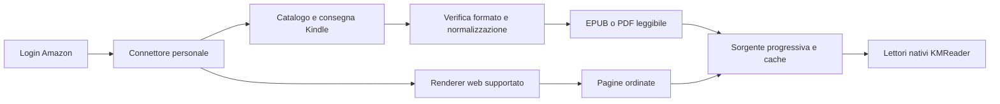

> Historical prototype record. Current procedures: [documentation](../../docs/README.md).

# Kindle personale: protocolli non ufficiali, download e streaming

Analisi del 4 novembre 2026, per un'installazione personale di KMReader. Questo
documento approfondisce percorsi di interoperabilità non ufficiali: non assume
un accordo commerciale con Amazon. Nessun account Amazon è stato utilizzato nelle
prove; distinguo codice pubblico esaminato, proposte e risultati sperimentali.

## Conclusione operativa

La strada concreta è un **connettore Kindle personale con più adattatori**, che
separi accesso alla libreria, acquisizione e trasformazione nel formato del lettore.
Il catalogo e i file possono arrivare dai servizi dei dispositivi Kindle oppure,
per i contenuti supportati, dai servizi del lettore web. Il contenuto normalizzato
va ai lettori EPUB/PDF/immagini di KMReader. Una pagina Amazon visibile durante
il login non diventa l'interfaccia di lettura.

Esistono basi di reverse engineering più pertinenti di un semplice login LWA.
Questo rende il progetto sperimentale concreto; non dimostra che ogni titolo e
ogni protezione attuale siano già compatibili. Un file scaricato può ancora essere
cifrato, un documento PDOC può essere MOBI o KFX, e un servizio web per manga non
equivale a un esportatore di tutti gli ebook testuali.

## I tre canali di acquisizione

| Canale | Evidenza disponibile | Impiego in KMReader | Punto da verificare |
|---|---|---|---|
| Servizi dei dispositivi Kindle | mkb79/kindle, Kindle_download_helper, ksync | Account, catalogo EBOK/PDOC, manifest e risorse | Login e registrazione con un profilo accettato oggi, sul marketplace effettivo |
| Renderer del lettore web | Kandle e dokuha documentano manga a impaginazione fissa | Pagine nel lettore nativo a immagini, anche progressive | Accesso al volume e compatibilità del tipo di contenuto; non generalizzare ai romanzi |
| Esportazione EPUB/PDF disponibile per il titolo | Documentazione ufficiale Amazon aggiornata al 2026 | Lettura diretta con i motori attuali | Disponibilità effettiva dell'offerta per l'acquisto |

Il terzo canale è una scelta preferenziale quando esiste, non l'unica strada
proposta. I primi due rispondono alla richiesta di un connettore personale non
ufficiale. Le strategie vanno selezionate in base alle risposte del servizio e al
contenuto effettivo del file, senza confondere acquisti, campioni e prestiti.

## 1. Client Kindle personale: una base già esistente

Ho individuato [mkb79/kindle, revisione 98c06a7](https://github.com/mkb79/kindle/tree/98c06a7073082cb0516a9359952cd1c4e9a26cdb).
Il repository si dichiara in sviluppo, è fermo al febbraio 2021 ed è AGPL-3.0.
Il suo codice comprende:

- `login.py`: login su Amazon, incluso `external_login` tramite browser e ritorno
  della sessione; il profilo è Kindle per iOS, non il normale login profilo LWA.
- `register.py`: registrazione del dispositivo e ricezione di credenziali bearer,
  rinnovo e firma ADP. Il codice esaminato usa un flusso storico basato su token.
- `api.py`: catalogo, sincronizzazione con timestamp, manifest ebook, download
  delle risorse e dei documenti personali, sidecar e informazioni Whispersync.
- `localization.py`: include anche Italia e distingue correttamente co.uk da uk.

Questo copre la parte di accesso che ksync lascia manuale. Non è una libreria da
installare e dichiarare funzionante nel 2026: profili, grant e risposte devono
essere verificati. Il suo flusso storico non implementa il moderno PKCE.

Come riferimento di evoluzione dell'identità Amazon ho esaminato anche
[mkb79/Audible, revisione 2460f9e](https://github.com/mkb79/Audible/tree/2460f9edff039d4b098d87be1fe7248381976bd7),
aggiornato nel novembre 2026: usa login esterno, codice e PKCE, seguito dalla
registrazione. **Un accesso Audible non concede accesso Kindle**: il progetto è
un riferimento per il meccanismo d'identità, non una credenziale sostitutiva.
Il login Kindle attuale con PKCE è il primo esperimento da validare.

Il flusso proposto è:

1. Creare un'identità locale stabile del connettore e aprire l'autenticazione sul
   dominio Amazon del marketplace, lasciando ad Amazon password e MFA.
2. Ricevere il risultato del login nel callback previsto dal profilo verificato.
   Preferire codice/PKCE quando supportato; non assumere che basti aggiungere
   parametri al vecchio flusso. Callback e modalità browser sono parte del PoC.
3. Completare la registrazione di quel dispositivo logico, conservando la stessa
   identità nelle sessioni successive. Usare le credenziali restituite per le
   richieste dei servizi, con rinnovo secondo le scadenze effettive.
4. Verificare il collegamento con una richiesta del catalogo e una consegna reale,
   non con la sola presenza di cookie o di un access token.

I servizi osservati nel codice includono `syncMetaData` per la libreria e manifest
distinti per ebook e documenti personali. Le richieste del dispositivo hanno firma
ADP; un generico token del login profilo Amazon non la sostituisce. Account,
marketplace, identità del dispositivo e scadenze devono restare coerenti.

Per il catalogo servono aggiornamenti/rimozioni e completezza verificata oltre il
primo blocco di risultati. I documenti personali hanno identificatori opachi:
non tutti seguono il formato degli ASIN commerciali. Non eliminare spazi dai
titoli o trasformare i metadati come fa parte del codice di esempio.

Una funzione da non importare automaticamente: nel downloader esaminato, alcuni
errori di manifest attivano la rimozione delle associazioni di consumo esistenti.
Il nostro connettore deve riportare il problema, senza scollegare altri dispositivi
o modificare la libreria per tentare di riparare un download.

## 2. Manifest, file e compatibilità effettiva

Il manifest è il documento di consegna, non ancora il libro aperto. Nel codice
esaminato compaiono risorse principali, metadati, allegati e voucher. Occorre
conservare tipo e dipendenze di ogni risorsa, revisione del contenuto, requisiti
di acquisizione e URL effettivi. Non basta scaricare la prima risorsa .azw.
La classificazione usa il contenuto reale: un'estensione AZW/KFX non prova da sola
che il file sia cifrato. Anche encryption.xml in un EPUB può descrivere soltanto
l'offuscamento standard dei font, già gestito da EpubHost, non un DRM sul libro.

| Contenuto ottenuto | Preparazione | Motore KMReader | Streaming iniziale |
|---|---|---|---|
| EPUB leggibile | Verifica del contenitore | EPUB attuale | Risorse via Range o directory virtuale |
| PDF leggibile | Verifica PDF e dimensione | PDF attuale, adattato a una sorgente progressiva | Letture casuali via Range |
| MOBI/KF8 leggibile | Conversione in EPUB | EPUB attuale | Prima acquisizione/conversione; streaming dell'EPUB risultante |
| KFX leggibile | Acquisizione del set necessario e conversione | EPUB o pagine native secondo il libro | Non presumere conversione incrementale; dipende dal contenitore |
| File protetto | Pipeline di compatibilità separata, verificata su quel file | Solo dopo aver ottenuto un contenuto supportato | Trasferire byte cifrati non rende il libro leggibile |
| Pagine del renderer web supportato | Ricostruzione delle pagine e del loro ordine | Lettore a immagini | Possibile per finestre di pagine |

Per l'uso personale esistono strumenti di compatibilità per alcuni formati e
combinazioni client/file. [DeDRM_tools](https://github.com/noDRM/DeDRM_tools) e
[KFX Input](https://www.mobileread.com/forums/showthread.php?t=291290) sono riferimenti
da valutare come componenti separati, non una prova di supporto universale alle
protezioni correnti. Il README di DeDRM avverte esplicitamente che la compatibilità
KFX cambia nel tempo. Non ho eseguito queste pipeline su libri Amazon.

Il modo concreto di affrontare anche gli acquisti è quindi provare un titolo
recente del proprio account attraverso acquisizione e normalizzazione complete.
Se una combinazione non è supportata, il connettore deve dichiararlo per quel
titolo, conservando catalogo e diagnostica. L'uso personale permette una soluzione
con componenti locali, ma non determina il formato né la protezione consegnati.

## 3. Un'altra via: il renderer web per i contenuti a pagine

Due riferimenti nuovi:

- [Alexia/kandle-downloader, 71f7e53](https://github.com/Alexia/kandle-downloader/tree/71f7e5346eddcc031a6899c091f13a2d80ba73fd),
  aggiornato nel marzo 2026, GPL-3.0. Implementa acquisizione di manga dal lettore
  web; il README indica il supporto al testo come lavoro futuro.
- [dokuha, protocollo Kindle](https://github.com/GolyBidoof/dokuha-userscript/blob/4195e5dd841f4c8ae6c619a76ba59621142ee29d/src/sites/kindle/README.md),
  ottobre 2026, MIT. Documenta volumi manga a impaginazione fissa e test sintetici
  del suo adattatore. Le acquisizioni reali citate sono degli autori, non mie.

Questi progetti descrivono una sessione di lettura autorizzata, metadati del volume,
finestre restituite dal servizio di rendering e risorse di pagina. La sessione
e le autorizzazioni hanno scadenza; un URL di pagina non è un indirizzo pubblico
permanente. La logica deve seguire le risposte della sessione corrente.

In KMReader questo può diventare `KindleRasterPages`, un'implementazione della
nostra interfaccia `RasterPages`: dimensioni, byte della pagina richiesta,
prefetch e cache. L'app usa i propri zoom, doppie pagine e curl. Si possono
acquisire prima le pagine vicine e salvare il resto in seguito.

Non è sufficiente ordinare i nomi delle immagini: ordine di lettura, pagine
singole/doppie, trasformazioni e ritagli provengono dai dati di pagina. Vanno
normalizzati prima del raggruppamento di KMReader, soprattutto in RTL.

Per un romanzo, ottenere pagine renderizzate non equivale a ottenere un EPUB
rifluibile: cambiare font, cercare testo e ricostruire paragrafi richiedono dati
testuali e una mappatura che questi progetti non implementano. È un percorso
alternativo per i contenuti supportati, non la dimostrazione che tutti gli ebook
si possano esportare come testo. La presenza di campi glyphs/tokens non prova che
sia già disponibile il testo Unicode completo.

Il vecchio [amazon-kindle-bulk-downloader](https://github.com/treetrum/amazon-kindle-bulk-downloader)
dichiara invece di non funzionare più dopo il 26 febbraio 2025: il download USB
storico non va confuso con questi altri canali.

## 4. Dove eseguire il connettore

| Esecuzione | Vantaggi | Costo/limite |
|---|---|---|
| Direttamente in Android/Windows | Nessun PC necessario per l'uso normale | Portare autenticazione, protocolli e convertitori sulle piattaforme; dipendenze e aggiornamenti più complessi |
| Companion sul proprio PC/server | PoC più rapido con strumenti esistenti; conversione fuori dal telefono | Il companion deve essere raggiungibile per nuovi contenuti e streaming non in cache |
| Ibrida | EPUB/PDF diretti nell'app; conversioni particolari sul proprio PC | Due percorsi da mantenere, con lo stesso modello di catalogo |

Per arrivare a una prova completa sceglierei prima il companion personale, poi
porterei nell'app autenticazione e consegna dei formati già supportati. Non serve
un servizio di terzi. Il lettore Android rimane leggero e le copie completate
restano leggibili offline anche quando il PC è spento.

Komga può ricevere gli EPUB/PDF normalizzati come una collezione Kindle e fornire
subito catalogo e download già integrati. Questa è una variante utile, ma un
connettore dedicato serve per gestire il login dall'app, lo stato della preparazione
e lo streaming progressivo con le relative disponibilità.

## 5. Streaming EPUB: prova concreta e cambiamenti al codice

Ho realizzato [epub_range_feasibility.py](../epub/epub_range_feasibility.py), un
prototipo isolato: genera un EPUB illustrato di 12 capitoli, lo espone con e senza
HTTP Range e usa il JavaScript EPUB realmente distribuito con KMReader. Non
contiene account, chiamate Amazon o modifiche al lettore di produzione.

[Risultati riproducibili](../../docs/benchmarks/kindle-epub-range-feasibility.json):

| Passaggio | Byte trasferiti cumulativi dal server origine |
|---|---:|
| Dimensione EPUB | 14.183.251 |
| Prima apertura con Range | 1.272.659, circa 8,97% del file |
| Apertura del secondo capitolo | 2.452.307 |
| Ritorno al primo capitolo | 0 byte aggiuntivi |
| Server senza Range | 14.183.251, ripiego sul file completo |

Il libro è generato e il server è locale. Il risultato dimostra la fattibilità
del trasporto e dell'apertura progressiva nel motore JS, non le prestazioni su
un dispositivo fisico, la compatibilità Amazon o il comportamento di ogni EPUB.
Il bootstrap ha letto un capitolo e la sua illustrazione, non tutti i capitoli.
Il prototipo effettua 20 richieste Range prima dell'apertura: in produzione vanno
accorpati gli intervalli contigui e misurato il tempo alla prima pagina. Meno byte
non implica automaticamente meno attesa, specialmente per libri piccoli e reti
con latenza elevata.

Il percorso tecnico è: indice ZIP, metadati OPF/indice, capitolo necessario,
CSS/font/immagini richiesti. Per una voce DEFLATE normalmente serve l'intera voce
compressa; non si può presumere di scaricare soltanto le righe visibili. I server
che ignorano Range richiedono download completo o un companion che esponga le
risorse del libro separatamente.

Nel codice attuale ci sono tre ostacoli specifici:

1. `DocumentReader.load` restituisce `Future<File>`: aspetta un file completo.
   Va affiancato da una sorgente documento locale/progressiva, mantenendo il percorso
   locale veloce già esistente.
2. `EpubHost` crea un `EpubDocument` da un archivio locale e serve `resource()` in
   modo sincrono. Serve un'interfaccia asincrona `readResource(path)` nel server
   locale, con implementazioni ZIP locale, ZIP remoto e directory virtuale del companion.
3. `EpubDocument.open` legge i capitoli privi di titolo nell'indice per ricavarne
   un'intestazione. In streaming questo può scaricare l'intero testo all'apertura.
   Il bootstrap deve usare OPF/nav/NCX e titoli provvisori, completandoli su richiesta.

Il motore Epub.js può quindi continuare a chiedere risorse al server locale.
Credenziali e URL Amazon restano nel provider; il browser del libro conserva il
suo confine di origine. Il prototipo prova proprio questo assetto, senza riscrivere
il renderer EPUB.

## 6. Streaming PDF e KFX

La dipendenza effettiva del progetto, `pdfrx_engine 0.8.0`, offre già `openCustom`
con letture casuali asincrone e `openUri` con preferenza per Range; `pdfrx` offre
`PdfDocumentRefCustom`. Oggi `PdfReader`/`PdfRasterReader` ricevono invece un `File`.
Una sorgente progressiva condivisa può alimentare PDFium e riutilizzare sia il
viewer PDF sia `PdfRasterPages`, senza cambiare il motore di rendering.
`PdfRasterPages.dimensions` presuppone però che pagine e dimensioni siano pronte:
prima di usarlo con caricamento progressivo bisogna coordinare i metadati o leggere
l'albero delle pagine. Non basta attivare un flag progressivo nel costruttore.

Preferirei `openCustom` con identità stabile del contenuto: l'URL firmato può
scadere e cambiare, mentre il libro e la cache devono restare gli stessi. Non tutti
i PDF consentono un'apertura economica: struttura e richieste di PDFium determinano
quanti blocchi servono prima della prima pagina.

Per MOBI/KFX, il primo traguardo realistico è acquisizione e normalizzazione sul
companion, seguite dallo streaming dell'EPUB/PDF risultante verso KMReader. È
streaming dal companion, non la prova che la conversione inizi prima di acquisire
le risorse sorgenti necessarie. La conversione incrementale per capitoli è una
fase successiva, da verificare sul formato reale.

## 7. Cache, rinnovi e fluidità

- Identità: account/marketplace/tipo/ID contenuto/revisione/versione del normalizzatore,
  separata dall'URL.
  Una nuova edizione non deve riutilizzare blocchi o posizioni della precedente.
- Scadenze: risolvere nuovamente URL e sessioni quando necessario; verificare
  identità della risorsa prima di riutilizzare blocchi già scaricati. Un 403 non
  prova da solo che il token sia scaduto.
- Trasporto: verificare 206 e Content-Range, gestire il 200 completo e conservare
  i blocchi su disco. Il prototipo usa una cache RAM limitata solo per la dimostrazione.
- Priorità: pagina/capitolo attuale e successivo prima dei lavori in background.
  Conversione e rete non devono entrare nei frame del curl. Una pagina non ancora
  disponibile non va simulata usando l'immagine precedente.
- Offline: il contenuto è completo solo dopo tutte le risorse necessarie e la
  verifica del risultato. Cache parziale e libro scaricato sono stati diversi.
- Credenziali: adattare il vault a un namespace Kindle; l'implementazione attuale
  usa chiavi server:id. Sessioni e codici di login non diventano metadati dei libri.
- Posizioni: conservare inizialmente quelle di KMReader. Una posizione KFX non è
  un CFI EPUB; la sincronizzazione bidirezionale richiede una mappatura dedicata.

## 8. Il PoC che decide il progetto

Prima di costruire tutta l'interfaccia, il prototipo autenticato deve completare:

1. Login del proprio account sul marketplace effettivo e sessione rinnovabile.
2. Elenco di acquisti e documenti personali, verificato oltre il primo blocco.
3. Acquisizione di un libro acquistato recente e di un documento personale.
4. Preparazione di un risultato realmente leggibile, identificando il percorso
   utilizzato e le eventuali incompatibilità per quel titolo.
5. Apertura nel motore KMReader, accesso alle pagine successive e lettura offline
   di un download completato.

In parallelo, provare un volume a impaginazione fissa tramite renderer web e
`RasterPages`; solo in seguito estendere quel percorso ai libri testuali se i dati
effettivi lo permettono. Non dichiarare supporto al testo sulla base del solo
downloader manga.

Il risultato di questa analisi è quindi un percorso non ufficiale verificabile e
una prova riuscita dello streaming nel motore EPUB. Login Kindle attuale, consegna
Amazon e compatibilità delle protezioni restano da provare con un account reale:
non vengono presentati come già implementati nella build 0.8.17.

## 9. Primo prototipo scaricamento Amazon.it

Su richiesta dell'utente il primo esperimento eseguibile è ora limitato al
**download**, con streaming rimandato. I sorgenti sono in
[`tool/kindle_personal`](../../tool/kindle_personal/README.md), separati dai runtime
Android/Windows dell'app. Il workflow `kindle-prototype.yml` verifica Linux e
Windows e prepara un eseguibile Windows x64 con browser Edge esterno e archivio
credenziali DPAPI; l'utente non deve installare Python o avviare un runner.

Il prototipo implementa identità stabile, tentativo di login PKCE e alternativa
storica esplicita, registrazione, rinnovo, richieste firmate, catalogo EBOK/PDOC
con aggiornamenti/rimozioni, manifest freschi e acquisizione atomica di tutte le
risorse. Un vecchio PDOC con manifest 404 può essere richiesto dall'endpoint di
consegna documenti storico. Non vengono rimossi dispositivi né scritti progressi
su Amazon. Il catalogo è testuale, senza copertine; la paginazione non ancora
confermata viene dichiarata parziale quando il limite o la risposta lo richiedono.

EPUB/PDF sono verificati strutturalmente; altri formati possono essere sottoposti
a un Calibre installato separatamente. Dalla 0.1.4 il companion Windows separato
include kfxlib GPLv3+ per convertire offline i KFX non cifrati; l'eseguibile combinato
ha licenza GPLv3+ e viene consegnato insieme ai sorgenti corrispondenti. L'app
Flutter MIT non importa il convertitore. Non trasferiamo automaticamente le credenziali del
dispositivo ai plugin. Quindi un acquisto protetto può restare nello stato
`needs_conversion` anche dopo aver scaricato tutte le risorse: non è ancora un
risultato leggibile e non è dimostrato supporto universale ai KFX correnti.

Le prove automatiche usano account, manifest e contenuti sintetici; verificano
anche il confine del browser reale, la firma, i trasferimenti interrotti, la
separazione degli account e l'assenza di segreti nei report. Una richiesta
anonima ai due flussi login dall'ambiente cloud ha ricevuto HTTP 503, senza
form di accesso: non costituisce una convalida né un rifiuto autenticato del
profilo. Il prossimo dato necessario è la prova locale dell'account Amazon.it,
poi un documento personale e un acquisto recente aperti nel motore KMReader.
