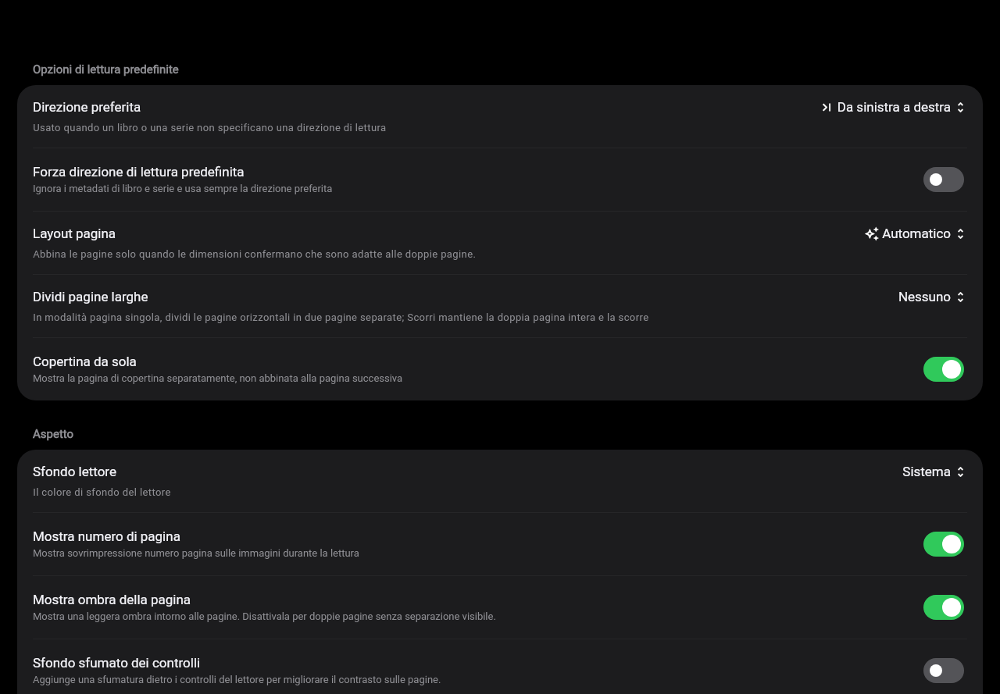
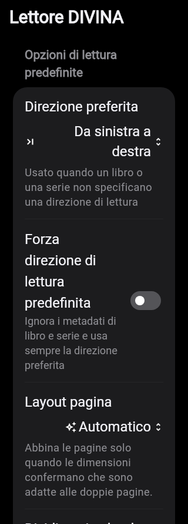
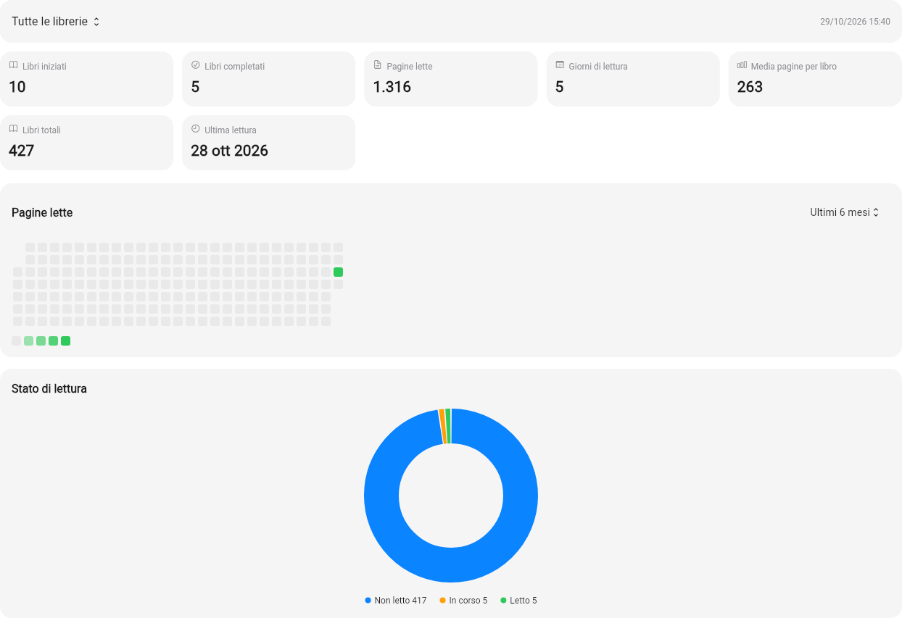

# iPad reference comparison

The user supplied five Italian iPad screenshots on 2026-10-29: the settings index,
offline books, browse/card preferences, reading statistics and image-cache settings.
They provide a partial visual reference. The subsequent dark DIVINA and statistics references additionally guide reader
preferences. They do not cover every setting, animation or the Windows/Android
interaction model. The books,
server data and installed fonts differ from the synthetic comparison fixtures.

## Implemented from this comparison

- Grouped settings index with colored category icons, rounded groups and inset
  separators. Existing account, server, download, cache and PDF actions remain
  reachable through their categories.
- A settings-owned navigator keeps the wide sidebar visible in subpages and
  handles Back only while that tab is active. Reader launches use the root
  navigator so the sidebar does not consume the reader viewport.
- A 304-pixel sidebar at the reference's 1280-pixel width, a neutral background
  and rounded selection. Narrow desktop windows use 260 pixels; phone navigation
  retains the bottom bar.
- Browse settings use the original preference names, defaults and translations:
  text overlay, cover-only mode, series titles, preserved aspect ratio, shadows,
  badges, unread-cover blur, progress and search filter bypass.
- Live card previews share their renderer with catalog/dashboard grid cards.
  Overlays take precedence over cover-only mode without erasing its saved value.
  Badge/shadow geometry follows the decoded cover frame, including small covers
  scaled to the available area, without a second image decode. Started series
  are excluded from unread blur.
- Changing presentation options rebuilds the view without refetching catalog or
  image bytes. Search bypass omits user filters while retaining the view's
  structural scope and library; clearing the query restores the filters.
  Select-all uses the same effective conditions and library as the visible query.
- Reading statistics opens a separate page from Settings; history remains available separately. Seven summary tiles, weekly heatmap with all seven periods and a status donut follow the reference.

## Comparison still required

| Supplied view | Outstanding difference |
| --- | --- |
| Settings index | Global DIVINA, EPUB theme/preferences, PDF, reader-general and real-time category pages are implemented; verify native spacing, row heights and popovers against the original. See [settings audit](SETTINGS_AUDIT.md) for adaptations and remaining model-library gaps. |
| Sidebar | The original's exact Offline/Server destinations, collapsible library section and sidebar-collapse control are not yet reproduced. |
| Offline | Match the two summary tiles, library/size scope, grid presets and downloaded-book status presentation. |
| Reading statistics | Metric tiles, weekly heatmap, seven time ranges and status donut are implemented. Compare native rendering and data semantics using the same library. |
| Cache | Separate page/cover quotas, cover expiry, byte/count statistics and current/all-account clearing are implemented, with migration and protection of downloaded originals. Native visual matching and physical-device cache acceptance remain. |
| Typography and controls | Check production fonts, native switches/popovers, row metrics, dark mode, accessibility and more screen sizes. |

The preview images below are Flutter widget renders using synthetic data, not
native iPad captures or evidence of exact pixel parity. The large-screen viewport
matches the supplied 1280 × 889 images; the phone viewport is 390 × 844.

## 0.8.0 settings refinement

DIVINA forms follow the reference groups and order, with the unified four-direction picker, inverted Force Default toggle, conditional layout/cover/split rows and full captions. Values align to the trailing edge on wide windows; narrow windows stack long labels and values. A shared theme supplies grouped backgrounds, separators, green switches and consistent row/caption metrics. Cache rows no longer nest two cards. Appearance follows Language, App Icon, Theme, Navigation and Privacy. Settings index order matches reference groups, with port-specific download/account actions retained below them.

EPUB themes use the four original theme swatches, typography scale ranges, weight override, advanced groups and separate preset/font screens. Native PDF includes Vertical; rendering/presentation controls follow source visibility rules. Network uses numeric timeout fields and retry stepper; real-time sections include source explanatory footers. Apple-only settings are not replaced by inert controls; model-library gaps remain explicit in the audit.

Widget fixtures verify 320/1280 widths, Italian localization and enlarged text. They do not establish pixel equality on physical Android/Windows devices.

