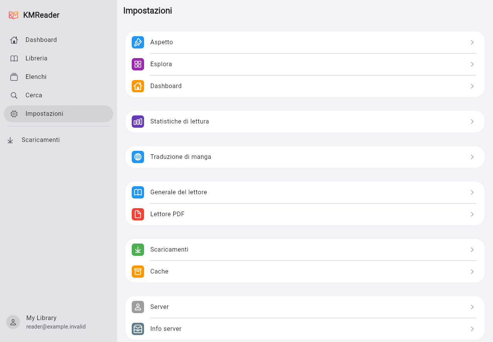
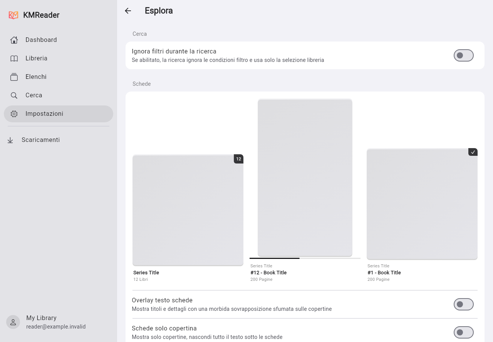
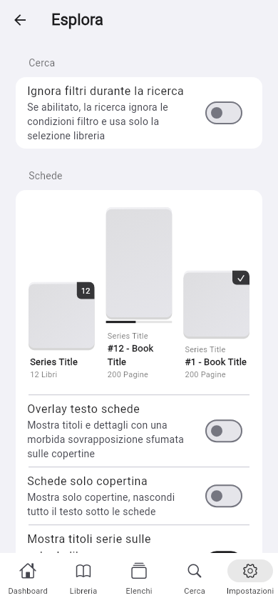

# iPad reference comparison

The user supplied five Italian iPad screenshots on 2026-10-29: the settings index,
offline books, browse/card preferences, reading statistics and image-cache settings.
They provide a partial visual reference. They do not cover the readers, every
setting, dark mode, animation or the Windows/Android interaction model. The books,
server data and installed fonts differ from the synthetic comparison fixtures.

## Implemented from this comparison

- Grouped settings index with colored category icons, rounded groups and inset
  separators. Existing account, server, download, cache and PDF actions remain
  reachable through their categories.
- A settings-owned navigator keeps the wide sidebar visible in subpages and
  handles Back only while that tab is active. Reader launches use the root
  navigator so the sidebar does not consume the reader viewport.
- A 304-pixel sidebar at the reference's 1280-pixel width, a neutral background
  and rounded selection. Narrow desktop windows use 260 pixels; phone navigation
  retains the bottom bar.
- Browse settings use the original preference names, defaults and translations:
  text overlay, cover-only mode, series titles, preserved aspect ratio, shadows,
  badges, unread-cover blur, progress and search filter bypass.
- Live card previews share their renderer with catalog/dashboard grid cards.
  Overlays take precedence over cover-only mode without erasing its saved value.
  Badge/shadow geometry follows the decoded cover frame, including small covers
  scaled to the available area, without a second image decode. Started series
  are excluded from unread blur.
- Changing presentation options rebuilds the view without refetching catalog or
  image bytes. Search bypass omits user filters while retaining the view's
  structural scope and library; clearing the query restores the filters.
  Select-all uses the same effective conditions and library as the visible query.
- Reading statistics opens the statistics tab directly; history remains available.

## Comparison still required

| Supplied view | Outstanding difference |
| --- | --- |
| Settings index | Global DIVINA/EPUB theme/EPUB preferences and real-time-update settings need their own complete category pages. The port exposes several of those options inside the readers today. |
| Sidebar | The original's exact Offline/Server destinations, collapsible library section and sidebar-collapse control are not yet reproduced. |
| Offline | Match the two summary tiles, library/size scope, grid presets and downloaded-book status presentation. |
| Reading statistics | Match metric tiles, heatmap/donut styling, time ranges and data semantics against the same library. |
| Cache | The current image disk cache is a shared 512 MiB target. Separate page/cover quotas, cover expiry, byte/count statistics and current-account/all-account clearing need implementation and validation. Downloaded originals must remain protected. |
| Typography and controls | Check production fonts, native switches/popovers, row metrics, dark mode, accessibility and more screen sizes. |

The preview images below are Flutter widget renders using synthetic data, not
native iPad captures or evidence of exact pixel parity. The large-screen viewport
matches the supplied 1280 × 889 images; the phone viewport is 390 × 844.

