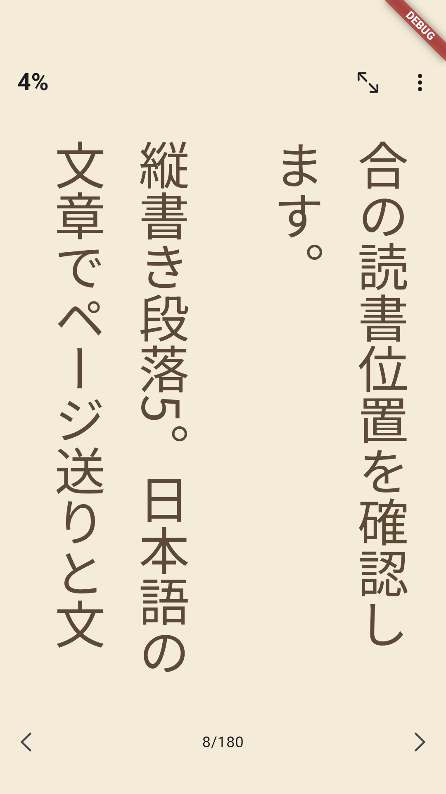
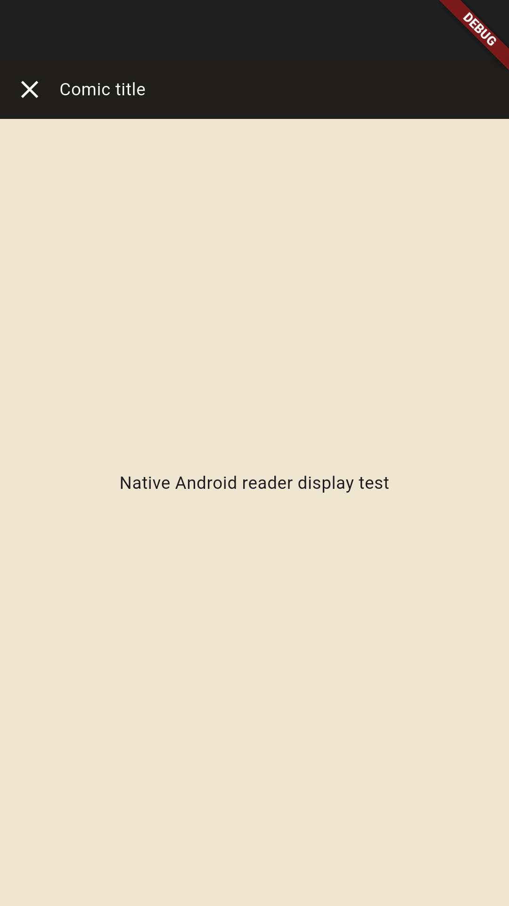
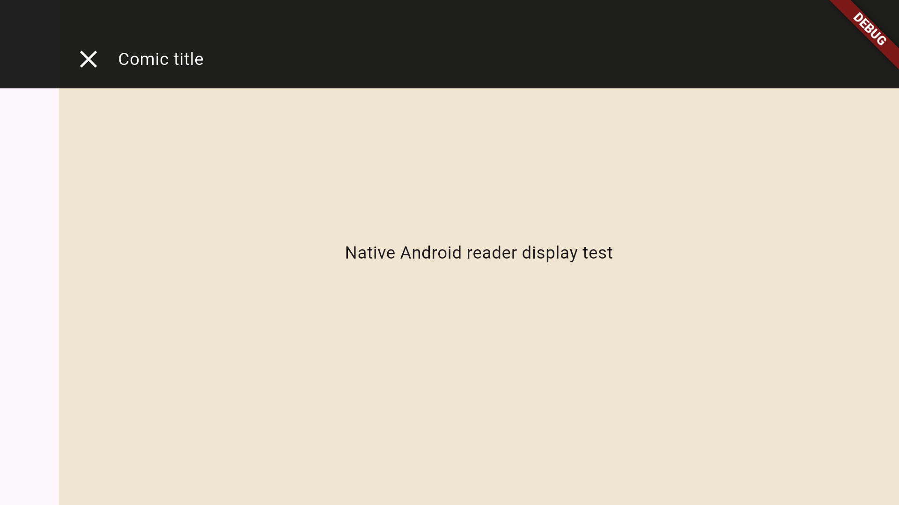
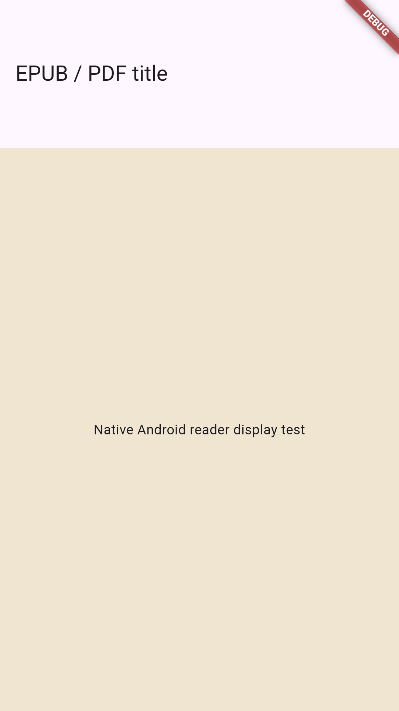
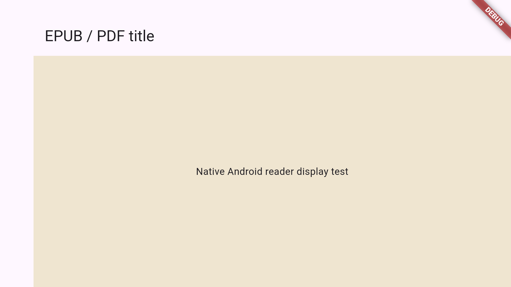
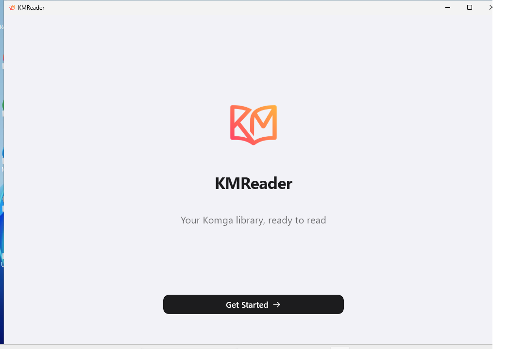

# Development validation

## 1.0.0+31 development — 2026-11-07

This source revision adds the curl layer correction, separate Send-to-Kindle
OAuth/diagnostics, partial PDOC management, and F-08/F-09 offline/live metadata
work. Verified runtime/test source: `2f3c6385bdd6e2c2a25e65b192af6a0e92a0dc69`. The
[build 31 candidate](https://github.com/LeValue/KMReader-Porting/releases/tag/untagged-79ed866c31844ad0e3f8)
is delivered; build 30 and all earlier assets remain preserved.

Local checks on the development source:

- `flutter analyze --no-pub`: no issues.
- Complete `flutter test --no-pub`: **416 passed, 34 skipped**. Skipped opt-in
  checks are not counted as executed.
- `python3 -m unittest discover -s tool/tests`: **13 passed**.
- Real, isolated Komga 1.29.1: authentication, search, CBZ/EPUB/PDF downloads,
  offline progress and WebPub synchronization passed. The final source is also
  exercised by the main CI backend job.
- The tilted spread pixel regression fails with the former painter in both
  directions and passes with the correction; it is included in the shared native
  Android spread checks as well as host tests. Both native runs passed on this source.
- EPUB editing tests cover original/content/identity preservation, real cover
  encoding, proportional 2048-pixel bound, existing cover replacement, unsupported
  layout rejection and accurate UTF-8 declarations for UTF-16 source metadata.
- Remote mutation fixtures cover PDOC-only scope, backups/journal, uncertain
  responses without replay, catalog readback and retaining the original during
  incomplete state migration. OAuth fixtures reject unrelated accounts and keep
  reading credentials separate.
- The retained Android certificate matches
  `d95f940bec20cec8563c946df8c62de1922852b9b5d3bf3a7765e9dc1b10322e`.
  Five pre-existing APK outputs were preserved before building. Remote inventory
  preserved **43 releases / 171 assets**; after the new draft it contains
  **44 releases / 176 assets**, with main as the only remote head.

[CI 42413142048](https://github.com/LeValue/KMReader-Porting/actions/runs/42413142048)
passed `android`, `windows` and `android_reader_display`, including native Windows
WebView2, actual Android rendering/insets, Chromium, prepared Kindle books, ONNX,
Komga and optimized builds. The initial
[680bb86 run](https://github.com/LeValue/KMReader-Porting/actions/runs/42396906772)
passed Android/native Android but failed one Windows file-picker regression: its
fixture mixed path separators and assumed file I/O completed after 50 ms.
`2f3c638` uses a native path and waits for the selected filename. No application
code changed for that correction; both CI outcomes remain available.

[Delivery 42415254325](https://github.com/LeValue/KMReader-Porting/actions/runs/42415254325)
reconstructed the exact locally signed APKs from bounded transport blobs and the
verified unsigned CI base. The signing key never left the local environment.
All five uploaded assets were downloaded again and match GitHub's SHA256 digests;
all **710 Windows files** match the verified CI artifact individually.

| Downloaded file | Bytes | SHA256 |
|---|---:|---|
| `KMReader-1.0.0-android-arm64-preview.apk` | 107000835 | `d61545fa7efdb2bea74c9b6971dc216df549426d1a64b52dc8273f2cb9d814b8` |
| `KMReader-1.0.0-android-armv7-preview.apk` | 88121655 | `ceda8dde29ad3577af9885412e7ec8a3249b8d6bc768e33f5d02c1ef1ce81f2c` |
| `KMReader-1.0.0-android-x64-preview.apk` | 113452279 | `7d63b847d3c17b9f33de40f2815eb9a7c433d5dac33a552ca36dfeb57fc7247a` |
| `KMReader-1.0.0-windows-x64-preview.zip` | 104720133 | `45b6f92f26c5578ecd40de1662aeb810e445ed6446f96228e1eed3dba80e4cd4` |
| `SHA256SUMS.txt` | 424 | `42cfb5aaa7f2f6e2dc52de74f1baf68a3ed94ffff5cea20ba69a44d45e5bb2b8` |

The local build environment needed a user-owned Python 3.11 installation and a
writable Kotlin daemon directory. These were environment adjustments; the
retained key/properties hashes are unchanged, and five prior APK outputs were
copied before building. No branch, older release, tag or asset was removed.

These checks do not establish real Amazon upload/deletion acceptance,
physical-device upgrade behavior, or full porting parity. Complete overwrite with
cloud bookmark/state migration remains unimplemented. See [the matrix](PARITY.md)
and [PDOC management limits](KINDLE_LIBRARY_MANAGEMENT.md).

Historical read-only report
[42308712643](https://github.com/LeValue/KMReader-Porting/actions/runs/42308712643)
(source `a5e51aa`, artifact `kindle-personal-read-only-probe`) exposes bookmark
field names in JSON. All four legacy XML filters returned only last-read records;
that report supplies no verified cloud bookmark-write contract. It is not a test
of build 31 and does not close K-04 or AT-06.

## 1.0.0+30 candidate — 2026-11-07

Application source: `4b93c91ddfd5b847f92dcdb888643e96dc1320a6`, on main.
The [downloadable candidate](https://github.com/LeValue/KMReader-Porting/releases/tag/untagged-2331050a86fdd8512d55) is a new draft; existing 0.9.x drafts and
published releases are preserved. No stable publication or new PR was made.

[CI 42371503059](https://github.com/LeValue/KMReader-Porting/actions/runs/42371503059)
passed `android`, `windows` and `android_reader_display` for this exact source.
This includes both host suites, the real Komga backend, Chromium, prepared Kindle
runtime, ONNX checks, native Android/Windows readers, release builds and Windows
startup in an isolated profile. Local analysis has no issues. Release-tool tests
also pass: 13 after adding support for version-matched 1.0 draft delivery.

The [first native Android attempt](https://github.com/LeValue/KMReader-Porting/actions/runs/42371503059/attempts/1)
printed successful WindowInsets and reader results, then lost its VM-service/ADB
connection before the driver accepted the final response. That job failed and
is not counted as a pass. Re-running only that job on unchanged source completed
successfully, including the driver response. The underlying interruption is not
attributed to a confirmed app or emulator defect; both attempts remain recorded.

[Delivery 42383704677](https://github.com/LeValue/KMReader-Porting/actions/runs/42383704677)
rechecked complete CI and unchanged application/runtime paths, reconstructed the
byte-exact locally signed APKs from bounded transport blobs, verified their
certificate, ABI, package/version, provenance and 16 KiB alignment, then attached
them with the matching Windows bundle and SHA256SUMS. The Android private key
never left the local build environment. Delivery did not publish the draft.

All five release assets were downloaded again. Their bytes match GitHub's asset
digests and SHA256SUMS; each APK also matches the original local signed file.
All **710 files** in the Windows archive match the source-verified CI artifact,
including native libraries, the MSVC runtime, Kindle converter, corresponding
source archive and notices. APK/Windows checksums:

| Candidate artifact | SHA256 |
|---|---|
| `KMReader-1.0.0-android-arm64-preview.apk` | `e6be47e5b5872477d0d22071eb32f5d05961efec8d5e75c9ca70ebec5703b771` |
| `KMReader-1.0.0-android-armv7-preview.apk` | `7bddb997d853918be0b18aecbd74a9c065a094500d0d205bdb6c57e4c2cc7591` |
| `KMReader-1.0.0-android-x64-preview.apk` | `abcc8cb0a0811fcce950322e99af72aaa0b777f6f4e9b6ea7c9cd452ad587961` |
| `KMReader-1.0.0-windows-x64-preview.zip` | `f9d6edab9687ff5bc7f8133699edb2992cdfdadf5ba5ce70fe71303b21fff06b` |

The seven requested changes are described in the [release notes](releases/v1.0.0.md)
and [Kindle import guide](KINDLE_IMPORT.md). New coverage checks paper-relative
mouse gestures and fading single sheets, a 2,400-book UI-event regression,
account closure during queued/index work, full/incremental dictionary filtering
including classification recovery from old snapshots, and streamed Kindle import
with cancellation and non-replayed ambiguous delivery. Dashboard regressions
separate EPUB/PDF books from DIVINA comics **before pagination**, cover old or
missing publication dates, and preserve Kindle acquisition/first-seen dates.
The split queries also passed against real Komga 1.29.1. See All shares them.

The original signing configuration/keystore hashes are unchanged. The initial
inventory's **42 releases and 166 assets** retain their IDs, names, sizes and
available digests; the new candidate adds five assets without replacing them.
Application data schema, account boundaries and archived source history are kept.

Still open for target-device/account acceptance: real Amazon upload/conversion
and delivery, an in-place upgrade from signed 0.9.1, and confirmation on the
Windows machine that reported the freeze. Synthetic/hosted tests do not establish
those results. AI/model/translation extensions and Komga server upload remain
future features. The 1.0 candidate stays in draft pending that acceptance.

## Pre-1.0 document metadata recovery — 2026-11-07

The next publication target is [1.0](ROADMAP_1.0.md); existing 0.9.x drafts remain
unpublished and this historical verification used source version 0.9.1+29.

A main-branch Komga run failed when a conditional document HEAD connection was
interrupted. A deterministic socket-close regression reproduced the missing
configured retry in `DocumentCache.revalidate`. HEAD metadata now uses the same
buffered safe-read retry policy as JSON reads, preserving conditional headers,
HTTP 304 and the immutable cached document. The zero-retry default remains
unchanged. The live Komga fixture explicitly enables one safe-read retry.

Local checks after this change:

- The new cache regression failed before the fix and passes after it.
- API/cache suites: **16 passed**, including configured limits 0/1/2, response
  interruption, HTTP 304, immediate authentication failure and non-replayed writes.
- Full Flutter suite: **366 passed, 34 optional skips**; analysis has no issues.
- Isolated official Komga 1.29.1 test: **passed** after the fix. It also passed
  once on unchanged source; the original server interruption is not attributed
  to a known server defect.

[Main CI 42364220405](https://github.com/LeValue/KMReader-Porting/actions/runs/42364220405)
passed `android`, `windows` and `android_reader_display` for source
`e19fd64f13cdf0f5317f44b5e6dc59110fece6bb`, including the real backend,
Chromium, ONNX, native integrations, release builds and Windows startup.
Publication and draft-delivery jobs were skipped.

The local ARM64 APK from that source passed retained certificate/package/ABI,
embedded provenance, version 0.9.1+29 and 16 KiB alignment checks. The private
signing configuration and keystore hashes are unchanged. APK SHA256:
`82d94032adccc67b31d5d57913af40fc8dff62f831392d3142c75cc0c2f253b2`.
No target-device/account acceptance or 1.0 publication is claimed here.

## Repository organization from working 0.9.1 — 2026-11-07

Working baseline: `a5e51aa44e59a4ff5d01dedfb83a70c53c126aa7` (0.9.1+29),
retaining diagnostic-only follow-ups through `63ad4e7`. See the
[comparison and retention audit](REPOSITORY_AUDIT.md) and
[exact branch/tag/release/asset snapshot](inventory/repository-before-2026-11-07.json).
The earlier entries below describe their named versions, not current source.

Local cleanup checks on Linux with Flutter 3.47.8 / Dart 3.13.7 / Python 3.11:

- `flutter pub get --enforce-lockfile`, `flutter analyze`: passed; no analysis issues.
- Format check: 217 files, zero changes.
- Complete ordinary Flutter suite: **360 passed, 34 optional tests skipped**.
- Python release/tool suite: **11 passed**.
- Shared Kindle Python suite with real Chromium enabled: **82 passed**; Windows-only
  operations are platform-gated. Synthetic self-check passed registration, signed
  catalog, offline EPUB/PDF/KFX preparation, persistent RPC reuse, progressive
  decoding and Kindle positions; no Amazon account was contacted.
- Opt-in Chromium reader suite plus prepared-book app import: **33 passed**.
- Real ONNX upscaler/bubble runtime tests: **7 passed**.
- Isolated official Komga 1.29.1 backend test: **1 passed**, including download,
  offline progress and WebPub sync; no existing server was modified.
- Actionlint 1.7.12 on active workflows: passed; embedded shell/Python lint helpers
  disabled (`-shellcheck= -pyflakes=`). Local Markdown links and `git diff --check`
  passed.
- Original 0.9.1 ARM64 APK downloaded from draft release 437138822: SHA256,
  GitHub asset digest/size, retained certificate, version/build, Preview package,
  ABI, embedded source and 16 KiB alignment verified. The existing asset was not
  replaced. SHA256: `c2d2cfe0112236ab5b30990c61a7ed90420d8a4f2918063fe0a81ae3b6bdbdb0`.

The PR checks provide new hosted Android/Windows/native verification for the
cleanup commit. Baseline [CI 42307062098](https://github.com/LeValue/KMReader-Porting/actions/runs/42307062098)
already passed all three required jobs at `a5e51aa`; that result is retained as
baseline evidence only. Personal-account and physical-device workflows are not
run by this cleanup. Local APK build and final hosted results are reported in the PR's verification record.

## 0.8.12 preview — EPUB input work and chapter lifetime

Published [0.8.12](https://github.com/LeValue/KMReader-Porting/releases/tag/v0.8.12-preview.1),
runtime source `da6545fe21941f036db784b5538ed85aaad2c88d`.
[Exact-source CI 41618748905](https://github.com/LeValue/KMReader-Porting/actions/runs/41618748905)
passed Android release, Windows native/release/startup and Android native/display
checks. [Publisher 41621460757](https://github.com/LeValue/KMReader-Porting/actions/runs/41621460757)
reused the verified Windows artifact and locally signed APKs.

All 331 host tests pass with Chromium and ONNX enabled; one live-Komga host test
is skipped without its external configuration. CI separately tests the actual
Komga client. The final code also passes all 20 browser checks, including 544
CFI comparisons with the stock mapper, stable reduced-content-box reads and
chapter-observer destruction. Existing native checks preserve real glyphs,
selection, live preferences, fixed pages, CJK, gestures, shadows, animation
intermediate frames and renderer recovery.

Paired runs on MATEBOOK used its existing local Alice EPUB (189,851 bytes,
SHA256 `23ba9d11f7c5f606431becb672b5577927569074bb02c3dab875bc81bf184139`),
a 1266x682 logical viewport at DPR 1.25, i5-10210U, Intel UHD and a nominal
60 Hz display. The original 0.8.11 runtime and each candidate use identical
standalone instrumentation and normal Flutter frame scheduling. The book stayed
on the PC. [Durable data](benchmarks/epub-windows-0.8.12-matebook.json) retains
source identifiers and measurement limits.

In [paired run 41616746989](https://github.com/LeValue/KMReader-Porting/actions/runs/41616746989),
the content-box candidate `4c45d54` measured:

| Check | 0.8.11 | Candidate |
|---|---:|---:|
| First curl: input to animation ready | 735 ms | 355 ms |
| Three middle-chapter vertical turns: browser task duration | 87 ms | 29 ms |
| Settings visible during an injected 800 ms browser task | 834 ms | 39 ms |

These are sampled readiness/task timings, not physical monitor FPS. Another
active paired run measured first-curl readiness at 415 vs 280 ms. Results vary
with cold initialization and machine load. Peak private memory did not show a
large reduction; chapter lifetime is now bounded by explicit observer/listener
cleanup rather than relying on weak keys alone.

The final-source [run 41618749777](https://github.com/LeValue/KMReader-Porting/actions/runs/41618749777)
completed functionally but delivered only a few native textures during motion.
Its timings are excluded from active-presentation claims. A launcher-only repeat
is queued with input-desktop checks, temporary visibility of the diagnostic
window, source-verified artifact reuse and a native-delivery gate. Physical
Mate 20 Pro performance remains unmeasured; Android passes emulator checks.

All five public assets were downloaded and checked against SHA256SUMS and
GitHub SHA256 digests. APK source/version/build 22, preview certificate,
non-debuggable status, ABI, reader asset and ZIP alignment match. Windows has
63 files matching CI byte-for-byte and 21 AMD64 PE files; its source metadata
and canonical reader asset also match.

| Download | Bytes | SHA256 |
|---|---:|---|
| [KMReader-0.8.12-android-arm64-preview.apk](https://github.com/LeValue/KMReader-Porting/releases/download/v0.8.12-preview.1/KMReader-0.8.12-android-arm64-preview.apk) | 77,637,646 | `eb75b7e661bc06f2b46e185ae5ff40bc88fa95278381fe8b8c4d2b688df38499` |
| [KMReader-0.8.12-android-armv7-preview.apk](https://github.com/LeValue/KMReader-Porting/releases/download/v0.8.12-preview.1/KMReader-0.8.12-android-armv7-preview.apk) | 64,003,936 | `dd4d6d467fe6b5bbf669b70082aac4232ae186c32c4ab4deeecde3084075bdbd` |
| [KMReader-0.8.12-android-x64-preview.apk](https://github.com/LeValue/KMReader-Porting/releases/download/v0.8.12-preview.1/KMReader-0.8.12-android-x64-preview.apk) | 83,939,027 | `8b90ea3019ff498094d18fa2b82ae914e92a61d6a76855a7f7667269e1ec5335` |
| [KMReader-0.8.12-windows-x64-preview.zip](https://github.com/LeValue/KMReader-Porting/releases/download/v0.8.12-preview.1/KMReader-0.8.12-windows-x64-preview.zip) | 34,451,673 | `679d197f38a4251d23c76af8075055d219c6a9e1df6ca351b465f85fc35241e3` |
| [SHA256SUMS.txt](https://github.com/LeValue/KMReader-Porting/releases/download/v0.8.12-preview.1/SHA256SUMS.txt) | 428 | `1ecb22e284323742b33e2d8aa870b8fdb5163f4bfa8e62cdd2459d92fb40e9d9` |

## 0.8.11 preview — physical Windows capture pacing

Published [0.8.11](https://github.com/LeValue/KMReader-Porting/releases/tag/v0.8.11-preview.1), runtime source `f4f0d806d83471c3cecf61cfdf9bb3f17132bb04`.
All exact-source verification jobs passed in [CI 41547276287](https://github.com/LeValue/KMReader-Porting/actions/runs/41547276287);
[publisher 41549744571](https://github.com/LeValue/KMReader-Porting/actions/runs/41549744571) reused that verified Windows artifact and the locally signed, verified APKs.

The user's interactive Windows 11 PC (RTX 2060 SUPER, nominal 144Hz display,
WebView2 156) ran the six-phase profile probe against its existing downloaded
Alice EPUB. The byte count, publication hash and 1264x681 viewport match the
baseline. [Physical run 41547276034](https://github.com/LeValue/KMReader-Porting/actions/runs/41547276034)
requires a successful live 1ms capture-interval readback and advancing native
capture/copy counters during slide, curl and scrolling. Idle, normal Flutter
sheets and the real reader settings are also exercised without synthetic 16ms
pumping. The exact-source release/native jobs retain all visible-pixel checks.

| Motion | 0.8.10 texture copies/s | Initial positive 1ms copies/s |
|---|---:|---:|
| Scorri / slide | 46.46 | 117.14 |
| Curl | 46.57 | 113.19 |
| Vertical scrolling | 46.77 | 124.74 |

These are native texture-copy rates, separately recorded from browser RAF and
Flutter engine timings. They do not measure physical monitor presentation FPS.
A controlled calibration also measured 46.53 copies/s with zero alone, 9.29
at 100ms, and 130.93 after switching from a nonzero interval back to zero.
This reproduces the Windows capture API maintainer's documented zero-initialization
bug; production requests a positive 1ms instead. See [details and graph](PERFORMANCE.md)
and the [durable timing summaries](benchmarks/epub-windows-0.8.11-rtx2060super.json).

All 327 host tests pass with browser/ONNX enabled, alongside static analysis,
formatting and eight Python checks. Windows passes 23 native checks, Android
22 plus both notch/rotation checks. Android rendering is unchanged from 0.8.10;
physical Mate 20 Pro frame rates remain unmeasured.

All five published assets were downloaded and checked against SHA256SUMS and
GitHub digests. The APKs match staged signed bytes, source/version/build 21,
preview certificate, non-debuggable flags, ABI and 16KiB library alignment.
All 63 Windows files (21 AMD64 PE files)
match the exact-source CI bundle.

| Download | Bytes | SHA256 |
|---|---:|---|
| [KMReader-0.8.11-android-arm64-preview.apk](https://github.com/LeValue/KMReader-Porting/releases/download/v0.8.11-preview.1/KMReader-0.8.11-android-arm64-preview.apk) | 77,635,170 | `378462f3229195e92eb76e45eff26ea20feb2e22c79c9788657dfc87fea103b6` |
| [KMReader-0.8.11-android-armv7-preview.apk](https://github.com/LeValue/KMReader-Porting/releases/download/v0.8.11-preview.1/KMReader-0.8.11-android-armv7-preview.apk) | 64,001,460 | `f4e0047c39312992c542ffb5ba26c6effb18a65cd4497967e4735530aa691796` |
| [KMReader-0.8.11-android-x64-preview.apk](https://github.com/LeValue/KMReader-Porting/releases/download/v0.8.11-preview.1/KMReader-0.8.11-android-x64-preview.apk) | 83,936,551 | `177c47f8649aa0261843b097d0c79d715ec1365e156dc23aef5b2ced3e94ecb2` |
| [KMReader-0.8.11-windows-x64-preview.zip](https://github.com/LeValue/KMReader-Porting/releases/download/v0.8.11-preview.1/KMReader-0.8.11-windows-x64-preview.zip) | 34,449,588 | `ea0cedc07546bfdf879d9e3a9e45d95c44244610fb88b9b698c37f97b72b6ee7` |
| [SHA256SUMS.txt](https://github.com/LeValue/KMReader-Porting/releases/download/v0.8.11-preview.1/SHA256SUMS.txt) | 428 | `0b5443c269f54e3328b334b3fb8d4790727c11411bfce1f30ec3fc3a4128a666` |

## 0.8.10 preview — smooth shadow filtering and EPUB presentation costs

Published [0.8.10](https://github.com/LeValue/KMReader-Porting/releases/tag/v0.8.10-preview.1),
runtime source `22b3d13541257da7b91952267494e58664e6427d`. All three exact-source build/native jobs passed in
[verification 41482311843](https://github.com/LeValue/KMReader-Porting/actions/runs/41482311843);
[publisher 41519063739](https://github.com/LeValue/KMReader-Porting/actions/runs/41519063739)
reused that Windows artifact and locally verified signed APKs.

All **327 host tests** pass with Chromium/ONNX enabled, plus formatting, static
analysis and eight Python checks. CI separately exercises the real Komga client.
The white-stock shadow regression keeps the existing receiver-continuity,
density and extent controls and rejects long flat bands in the gradient.
A 1044×720 control produces a 13-pixel plateau with the old sparse kernel and
at most one quantized pixel with the dense Gaussian replacement. Its shadow
mask drops from 522×360 to 185×128; publication texture resolution is unchanged.
GL probes require texture upload counts of **2, 1, 0, 1** across initial pages,
a sequential turn, idle preparation and a further turn. Endpoint pixels must
still identify the right page. A second probe runs the full production curl
start and requires exactly one upload plus correct front/back endpoint pixels.
These checks run in real native WebViews too.

Windows passes **23 native checks**, Android **22 native checks** plus both
notch/rotation checks. Android's attached WebView must have hardware acceleration,
the default layer and a real texture-composition parent. The existing selection,
menu, live typography, visible-pixel and renderer checks remain. Both platforms
exercise vertical scrolling with Flutter presentation active. Windows counters
must show worker-thread capture, advancing captures/copies and at most one GPU
copy per captured frame. Real renderer termination/recreation and isolated
Windows release startup also pass. Callback lifetime, capture leases and shutdown
are preserved across the free-threaded Windows capture path.

No 60 FPS cap was active in the preceding version. The checks establish reduced
rendering and presentation work; they do not measure physical Mate 20 Pro FPS
or establish 144 Hz on an RTX 2060 Super. See [implementation details](PERFORMANCE.md).

All five published assets were downloaded and checked against SHA256SUMS and
GitHub digests. APKs match staged signed bytes, source/version/build 20, the
preview certificate, non-debuggable flags, architecture and 16KiB native-library
alignment. All **63 Windows files**, including
**21 AMD64 PE files**, match the successful CI artifact.
Windows remains unsigned.

| Download | Bytes | SHA256 |
|---|---:|---|
| [KMReader-0.8.10-android-arm64-preview.apk](https://github.com/LeValue/KMReader-Porting/releases/download/v0.8.10-preview.1/KMReader-0.8.10-android-arm64-preview.apk) | 77,635,170 | `00a6b6a71d558a143466032da3070a538290021d32c037c647cda0679d8dd29e` |
| [KMReader-0.8.10-android-armv7-preview.apk](https://github.com/LeValue/KMReader-Porting/releases/download/v0.8.10-preview.1/KMReader-0.8.10-android-armv7-preview.apk) | 64,001,460 | `245996ca68eaaa18d288259bb44b0e7c9d107d8040a5b53fc1041be06c106087` |
| [KMReader-0.8.10-android-x64-preview.apk](https://github.com/LeValue/KMReader-Porting/releases/download/v0.8.10-preview.1/KMReader-0.8.10-android-x64-preview.apk) | 83,936,551 | `d78ee0753ee090ff8127db22243d00c884449878e604594a5b5ac2b0203afd8d` |
| [KMReader-0.8.10-windows-x64-preview.zip](https://github.com/LeValue/KMReader-Porting/releases/download/v0.8.10-preview.1/KMReader-0.8.10-windows-x64-preview.zip) | 34,448,821 | `20e6cd7c9480b4e9abd8cfa6225b2bd2e9b084ab3ca1e2737ab7e9e73f6f4f87` |
| [SHA256SUMS.txt](https://github.com/LeValue/KMReader-Porting/releases/download/v0.8.10-preview.1/SHA256SUMS.txt) | 428 | `ce2ae0e42a4719cd4d16442d3d8d451a688a62d10d68bc7c0993697cea69ebbb` |

## 0.8.9 preview — continuous curl shadows and automatic page motion

Published [0.8.9](https://github.com/LeValue/KMReader-Porting/releases/tag/v0.8.9-preview.1),
runtime source `bc785e1f6b1f541473f2ea8b1deda1fd6f7856e5`. All three exact-source build/native jobs passed in
[verification 41434072296](https://github.com/LeValue/KMReader-Porting/actions/runs/41434072296);
[publisher 41436828880](https://github.com/LeValue/KMReader-Porting/actions/runs/41436828880)
reused the verified Windows artifact and locally verified signed APKs.

All **327 host tests** pass with Chromium/ONNX enabled, plus formatting, static
analysis and eight Python checks. CI separately exercises the real Komga client.
White-stock GPU probes require matching shadow intensity on the background and
the flat front of the curled sheet. A control disables the front receiver and
must reproduce the old discontinuity. Density and penumbra width are checked
on the real native WebViews as well as Chromium. Dark-sepia frames are saved
for review.

Automatic EPUB slide/cover uses browser compositor snapshot animations with
a paced fallback. The browser gate requires two real pseudo-element animations.
Native checks require visible intermediate automatic slide progress. Gradual
shade returns to the lower sheet and soft shadows to its moving edge; comic
pixel checks require a spatial gradient and original colors at the endpoints,
while decoded artwork remains mounted.

Flutter page captures and pixel probes queue eager raster-thread snapshots to
avoid the Android worker snapshot conflict. Native Android pixel probes wait
for an explicitly numbered subsequent rasterized frame before CPU readback,
requesting frames until the engine delivers its timing report. They run before
renderer-lifecycle fixtures; all pixel assertions remain unchanged.
Timing tests inject late first frames and stalls, require monotone movement,
velocity-aware release and zero final velocity. The native comic snap retains
its spring through delayed frames. Actual reader widget tests cover automatic
slide/cover commands, a delayed frame and contact during the turn: it must
settle onto the nearest complete page after contact without a drag.

Windows passes **23 native checks**, Android **22 native checks** plus both
notch/rotation checks. Native WebViews exercise the same shadow-receiver control,
shadow density and extent, and automatic slide. The previous held-gesture,
centered-page endpoint, joined spread, theme and live-font checks remain.
Windows PDF setup prewarms a leaf last-error query on the existing PDFium worker,
preserving password errors across the Windows FFI boundary. Engine and binding
versions remain pinned; the parser and binary remain the same. The encrypted
PDF regression requires password prompting, wrong-password retry and no stored
credentials; a corrupt-file control must fail without asking for a password.
Fixed-layout probes suppress usable initial viewport locators and force a no-op
first manager turn. The single authored page must still expose a real canonical
spine CFI, advance exactly once and preserve publisher styling. Native selection
actions use a dedicated test mouse, separate from the live desktop device.
Both release builds and isolated Windows startup pass.

All five assets were downloaded and their SHA256SUMS and GitHub digests checked.
APKs match staged signed bytes, source/version/build 19, the preview certificate,
non-debuggable flags, architecture and 16KiB native-library alignment. All
**63 Windows files**, including **21 AMD64 PE files**,
match the successful CI artifact. Windows remains unsigned.
See [implementation and visual review](PERFORMANCE.md).

These checks establish state, geometry and rendering invariants; they do not
establish a fixed frame rate on every physical device or exact Apple Books parity.

| Download | Bytes | SHA256 |
|---|---:|---|
| [KMReader-0.8.9-android-arm64-preview.apk](https://github.com/LeValue/KMReader-Porting/releases/download/v0.8.9-preview.1/KMReader-0.8.9-android-arm64-preview.apk) | 77,634,570 | `2924478851e7732ff25f5785b5201a88cf0755c74be6aeb5d5a4807e7caf6694` |
| [KMReader-0.8.9-android-armv7-preview.apk](https://github.com/LeValue/KMReader-Porting/releases/download/v0.8.9-preview.1/KMReader-0.8.9-android-armv7-preview.apk) | 63,984,476 | `2c182f038f2318836689f430749e30ca1da925424dace566a382c2146078f971` |
| [KMReader-0.8.9-android-x64-preview.apk](https://github.com/LeValue/KMReader-Porting/releases/download/v0.8.9-preview.1/KMReader-0.8.9-android-x64-preview.apk) | 83,870,415 | `03268afee2f743d7d184878b16adeadf9273d458f8d414ec0520a7672c2cb377` |
| [KMReader-0.8.9-windows-x64-preview.zip](https://github.com/LeValue/KMReader-Porting/releases/download/v0.8.9-preview.1/KMReader-0.8.9-windows-x64-preview.zip) | 34,444,841 | `19039189c67ffb262231519a5a26a787ad3e8dd3849055a7dac823d69764e318` |
| [SHA256SUMS.txt](https://github.com/LeValue/KMReader-Porting/releases/download/v0.8.9-preview.1/SHA256SUMS.txt) | 424 | `0382aafb470186166a4438ebdb16b587b3b0f9f2ddd2f7b4696019250c259714` |

## 0.8.8 preview — projected shadows, joined comic spreads and live text settings

Published [0.8.8](https://github.com/LeValue/KMReader-Porting/releases/tag/v0.8.8-preview.1),
runtime source `82881fda76ecc653e7dc027cced65114d23af040`. All three exact-source build/native jobs passed in
[verification 41342039422](https://github.com/LeValue/KMReader-Porting/actions/runs/41342039422);
[publisher 41343757993](https://github.com/LeValue/KMReader-Porting/actions/runs/41343757993)
reused the verified Windows artifact and locally verified signed APKs.

All **321 host tests** pass with Chromium/ONNX enabled, plus formatting, static
analysis and eight Python checks. CI separately exercises the real Komga client.
A real pointer stays down and moves for eleven seconds without the EPUB fold
expiring or committing progress. White-stock GPU pixels require an exposed,
neutral cast shadow from the projected curved mesh; dark-sepia text frames are
saved for review. Reader-button tests require at least 4.5:1 contrast on white,
black, gray and dark-brown paper even with incompatible application icon colors.

Unequal comic leaves share a height and meet at the spine in both directions.
The same layout feeds live widgets, composed frames and curl bounds. A new
shared pixel regression compares progress .9999 against the final frame for
centered single pages and spreads, in both turn directions: releasing the
overlay cannot remove a visible page. Live-preview tests require one running
layout and one latest pending preference, applied before the panel closes.

Windows passes **23 native checks**, Android **22 native checks** plus both
notch/rotation checks. The endpoint pixel regression runs on native renderers.
Native WebViews require successful shadow framebuffer allocation with no GL
error. Typography checks inspect actual computed font size while Text Settings
remains open, require it to match persisted preferences and retain the saved CFI.
Both release builds and isolated Windows startup pass.

All five assets were downloaded and their SHA256SUMS and GitHub digests checked.
APKs match staged signed bytes, source/version/build 18, the preview certificate,
non-debuggable flags, architecture and 16KiB native-library alignment. All
**63 Windows files**, including **21 AMD64 PE files**,
match the successful CI artifact. Windows remains unsigned.
See [implementation and visual review](PERFORMANCE.md).

These checks establish state, geometry and rendering invariants; they do not
establish a fixed frame rate on every physical device or exact Apple Books parity.

| Download | Bytes | SHA256 |
|---|---:|---|
| [KMReader-0.8.8-android-arm64-preview.apk](https://github.com/LeValue/KMReader-Porting/releases/download/v0.8.8-preview.1/KMReader-0.8.8-android-arm64-preview.apk) | 77,633,114 | `ff02d581a7431b50df323df72d39c49b7cdb7381a0ea8d6b5508095aa5ee3542` |
| [KMReader-0.8.8-android-armv7-preview.apk](https://github.com/LeValue/KMReader-Porting/releases/download/v0.8.8-preview.1/KMReader-0.8.8-android-armv7-preview.apk) | 63,983,020 | `dcc9283e297c409a90c935820f2f884a9208d0490b29d81f3cde27f3f856c0c2` |
| [KMReader-0.8.8-android-x64-preview.apk](https://github.com/LeValue/KMReader-Porting/releases/download/v0.8.8-preview.1/KMReader-0.8.8-android-x64-preview.apk) | 83,868,959 | `aeef69619396043f754028e9a758dcf889c3bfd5924d4f30d370af81fd6be728` |
| [KMReader-0.8.8-windows-x64-preview.zip](https://github.com/LeValue/KMReader-Porting/releases/download/v0.8.8-preview.1/KMReader-0.8.8-windows-x64-preview.zip) | 34,435,889 | `5a2a087495521aa8b77909fb4adc43c094b0a3c845646c2490285206ea36abe8` |
| [SHA256SUMS.txt](https://github.com/LeValue/KMReader-Porting/releases/download/v0.8.8-preview.1/SHA256SUMS.txt) | 424 | `7ea37005ce2eb1d5905b334eb17d8547ccbdc9947d4def5559e10e77a6665a6e` |

## 0.8.7 preview — comic curl, minimal controls and local books

Published [0.8.7](https://github.com/LeValue/KMReader-Porting/releases/tag/v0.8.7-preview.1),
runtime source `20641b8b95e4028587bedb5fdf60be99d655c392`. All three exact-source build/native jobs passed in
[verification 41320852086](https://github.com/LeValue/KMReader-Porting/actions/runs/41320852086);
[publisher 41322552160](https://github.com/LeValue/KMReader-Porting/actions/runs/41322552160)
reused that Windows artifact and locally verified signed APKs.

All **313 host tests** pass with Chromium/ONNX enabled; the live Komga test is
separately exercised in CI. Formatting, static analysis and eight Python checks
pass. New checks reject comic taps/drags at page boundaries before capture,
require prepared turns to animate without screenshotting or early navigation,
and rasterize spread back faces in both directions without black filled shadows.
A long settings group builds only visible rows. Local-file checks cover
concurrent deduplication, restart/resume, natural comic ordering, owned originals,
EPUB/PDF recognition, invalid-file cleanup and exclusion from the Komga outbox.
Browser motion checks also attempt to turn before the first and beyond the last
page and require zero transition constructions and an unchanged CFI.

Windows passes **22 native checks**, Android **21 native checks** plus both
notch/rotation checks. The shared spread fixture runs on the native renderers.
The added serverless route imports a local comic, opens it through the welcome
screen, checks controls disappear/reappear without resizing the viewport, and
rejects final-page overlays. EPUB checks retain the live native view and its
bounds while controls toggle; typography checks scroll to lazy controls. Both
release builds and isolated Windows startup pass.

All five assets were downloaded and their SHA256SUMS and GitHub digests checked.
APKs match the staged signed bytes, preview certificate, source/version/build 17,
non-debuggable flags and architecture. Each 64-bit native library passes 16KiB
ELF LOAD alignment. All **63 Windows files**, including
**21 AMD64 PE files**, match the successful CI artifact.
Windows remains unsigned. See [implementation and limits](PERFORMANCE.md).

Supported local formats are EPUB, PDF and CBZ/ZIP; RAR/CBR is not implemented.
Prepared comic frames cover normal contained, unrotated pages/spreads; other
layouts retain snapshot fallbacks. Controlled checks establish rendering/state
invariants, not a guaranteed physical frame rate on every device.

| Download | Bytes | SHA256 |
|---|---:|---|
| [KMReader-0.8.7-android-arm64-preview.apk](https://github.com/LeValue/KMReader-Porting/releases/download/v0.8.7-preview.1/KMReader-0.8.7-android-arm64-preview.apk) | 77,633,278 | `68dfc0998f9db346f72d9f748c12cf2447ad5a95a57f2fb1e87aa2f91c72bd53` |
| [KMReader-0.8.7-android-armv7-preview.apk](https://github.com/LeValue/KMReader-Porting/releases/download/v0.8.7-preview.1/KMReader-0.8.7-android-armv7-preview.apk) | 63,950,416 | `6b76c6543b226d10e46f5fb55ca3a03fb42d263f5442f36410c66a0aad6f4bc7` |
| [KMReader-0.8.7-android-x64-preview.apk](https://github.com/LeValue/KMReader-Porting/releases/download/v0.8.7-preview.1/KMReader-0.8.7-android-x64-preview.apk) | 83,869,123 | `77ecbd868670ce904b2a16145e239ba6c4e1c842e7c2070bf6257865abf1f611` |
| [KMReader-0.8.7-windows-x64-preview.zip](https://github.com/LeValue/KMReader-Porting/releases/download/v0.8.7-preview.1/KMReader-0.8.7-windows-x64-preview.zip) | 34,430,825 | `293f94a8d4f71a01dab68d3389b755e1a2699a30ce6285e1a0c6d15d1b8b8a47` |
| [SHA256SUMS.txt](https://github.com/LeValue/KMReader-Porting/releases/download/v0.8.7-preview.1/SHA256SUMS.txt) | 424 | `c12f11fbb0c32d10e9f730895c779178373fbab0791d5d4b4d43cdbfcb01a6ef` |

## 0.8.6 preview — atomic rollback, localized curl and retained comic artwork

Published [0.8.6](https://github.com/LeValue/KMReader-Porting/releases/tag/v0.8.6-preview.1),
runtime source `3d04cd82715a768f0b05c4ec328b46cfd1a24a6b`. All three exact-source build/native jobs passed in
[verification 41206163826](https://github.com/LeValue/KMReader-Porting/actions/runs/41206163826);
[publisher 41262587609](https://github.com/LeValue/KMReader-Porting/actions/runs/41262587609)
reused that verified Windows artifact and the locally verified signed APKs.

All **306 host tests** pass with Chromium/ONNX enabled. Formatting, static
analysis and eight Python checks pass. Browser checks verify rollback **at
snapshot removal** for slide and curl, not only the eventual locator. Backward
spread curl must retain the stationary opposite leaf; texture endpoints match
the live publication in both directions. A white-stock GPU fixture samples a
raised free edge and requires a visible neutral cast shadow. Existing rapid-turn,
CJK, fixed-layout,
selection, resize, reduced-motion and renderer recovery checks remain.

New host regressions assert decoded artwork retains its widget state through
both animation endpoints, letterbox pixels stay outside the paper mesh, and
actual decoded image dimensions determine offline curl bounds. The deformation
reach survives comic/EPUB preference copies and global defaults. Geometry checks
cover straight/local-arc/roll joins, position/tangent continuity and local arc length.

Windows passes **20 native checks**, Android **19 native checks** plus both
notch/rotation checks. The added native comic fixture rasterizes forward and
backward folds at four progress positions and samples margin pixels to catch
black letterboxing entering the sheet. Native EPUB checks retain actual glyph
captures, fullscreen round-trips, arrows, selection actions, rapid turns and
WebView2 renderer recreation. Both release builds and isolated Windows startup pass.

All five released assets were downloaded and their SHA256SUMS/GitHub digests
checked. The APKs match the staged signed bytes, retained preview certificate,
source/version/build 16, non-debuggable flags, architecture and 16KiB alignment.
All nine libraries in each 64-bit APK pass 16KiB ELF LOAD alignment.
All **63 Windows files**, including 21 AMD64 PE files, match the
successful CI artifact. The release executable omits the debug wheel hook.
Windows remains unsigned. See [implementation and limits](PERFORMANCE.md).

Controlled fixtures do not establish physical-device frame rates or exact Apple
Books equivalence. Remaining porting differences stay explicit in [parity](PARITY.md).
Historical validation sections below describe their respective builds.

| Download | Bytes | SHA256 |
|---|---:|---|
| [KMReader-0.8.6-android-arm64-preview.apk](https://github.com/LeValue/KMReader-Porting/releases/download/v0.8.6-preview.1/KMReader-0.8.6-android-arm64-preview.apk) | 77,567,362 | `2a0fc2d5422f583afa0f16c056f85e04adcea40299eea8f9d6a9e20701c08b55` |
| [KMReader-0.8.6-android-armv7-preview.apk](https://github.com/LeValue/KMReader-Porting/releases/download/v0.8.6-preview.1/KMReader-0.8.6-android-armv7-preview.apk) | 63,900,884 | `fe28aacaae55c7b1b6ef82df67eef7f378643939d3a2d13af571bc6799b26acc` |
| [KMReader-0.8.6-android-x64-preview.apk](https://github.com/LeValue/KMReader-Porting/releases/download/v0.8.6-preview.1/KMReader-0.8.6-android-x64-preview.apk) | 83,868,743 | `157bfec8ab449e769ffdc5bb89c43d8b9bd3eaa964b992e17969b2ce520e1cbf` |
| [KMReader-0.8.6-windows-x64-preview.zip](https://github.com/LeValue/KMReader-Porting/releases/download/v0.8.6-preview.1/KMReader-0.8.6-windows-x64-preview.zip) | 34,404,220 | `7d710e5af060a6902c38078344ea2733d838229377a310fb74eb0df02c38f43b` |
| [SHA256SUMS.txt](https://github.com/LeValue/KMReader-Porting/releases/download/v0.8.6-preview.1/SHA256SUMS.txt) | 424 | `00cad39f2267d2c8e56c0aa23ece323e01a13844afd09323e166aa46ad7cf7cf` |

## 0.8.5 preview — desktop input, faster opening and GPU curls

Published [0.8.5](https://github.com/LeValue/KMReader-Porting/releases/tag/v0.8.5-preview.1), runtime source `0628968e2ad2dc80856ae017caf307fa2bdbca7e`.
All three jobs passed in [verification 41196927319](https://github.com/LeValue/KMReader-Porting/actions/runs/41196927319);
[publisher 41198455013](https://github.com/LeValue/KMReader-Porting/actions/runs/41198455013) reused that exact source and Windows artifact.

All **302 host tests** pass with Chromium and ONNX enabled. Formatting, static
analysis, eight Python checks, pinned 128-entry settings inventory and isolated
real Komga acceptance pass. Twenty warm Komga visits make zero additional HTTP
requests. New checks cover navigation-index-only worker ownership, menu alignment
inside a narrow panel on a wide desktop, slider dragging without form rebuilds,
and slide/cover layering in both directions. Existing cancellation, rapid turns,
large text, default EPUB, CJK and native renderer recovery guards remain.

Browser checks verify high-resolution GPU curl textures and their final rendered
pixels against the live publication. The visible front bends before the roll
arrives, with continuous tangent/arc-length checks. Changing the vertical drag
changes the fold;
PNG encoding is forbidden during the drag loop. Single/spread and RTL cases retain
mouse/touch, second-finger, cancellation and resize checks. Real margin clicks
cannot create a phantom selection, and options suspend book input. These are
controlled pixel/state checks, not equality with Apple's renderer or physical FPS.

Windows passes **19 native checks**, Android **18 native checks** plus
both notch/rotation checks. The default EPUB case now uses actual Flutter mouse
input, verifies clicks retain controls/OS window state, tests keyboard arrows,
and captures rendered glyphs during a held WebGL curl. Fullscreen round-trips and
real WebView2 crash/recreation remain tested. The first Android attempt lost its
ADB/driver connection after the notch checks; the repeated job passed on unchanged
source. Both native release builds and
isolated Windows startup pass. See [implementation and limits](PERFORMANCE.md).

All five release assets were downloaded and their SHA256SUMS/GitHub digests checked.
The three signed, non-debuggable APKs match locally verified bytes and embedded
source/version/build 15. Retained package/certificate support in-place updates.
All APKs pass 16KiB ZIP alignment; all nine libraries in each 64-bit APK pass
16KiB ELF LOAD alignment. All **63 Windows files**, including
21 AMD64 PE files, match the exact successful CI artifact.
The release executable omits debug wheel injection. Windows remains unsigned.

GPU/artwork paths that cannot prepare a safe texture retain direct reading.
Complete upstream parity and physical-device frame-time acceptance remain open;
see [parity](PARITY.md). Historical results below describe their respective builds.

| Download | Bytes | SHA256 |
|---|---:|---|
| [KMReader-0.8.5-android-arm64-preview.apk](https://github.com/LeValue/KMReader-Porting/releases/download/v0.8.5-preview.1/KMReader-0.8.5-android-arm64-preview.apk) | 77,565,814 | `a2d8b1b82061aeccae76ecb4d207b285dffb97ae46c20732b1627bfe55d86ade` |
| [KMReader-0.8.5-android-armv7-preview.apk](https://github.com/LeValue/KMReader-Porting/releases/download/v0.8.5-preview.1/KMReader-0.8.5-android-armv7-preview.apk) | 63,882,952 | `2241e90c779446396b9f9f97fc9d2717841e61a043924c1cc4ef326d57f10271` |
| [KMReader-0.8.5-android-x64-preview.apk](https://github.com/LeValue/KMReader-Porting/releases/download/v0.8.5-preview.1/KMReader-0.8.5-android-x64-preview.apk) | 83,801,659 | `215d3e7c6fbac32659a3fdd1d6acaac2456c6f3e2b627e2fa11404e128c3d020` |
| [KMReader-0.8.5-windows-x64-preview.zip](https://github.com/LeValue/KMReader-Porting/releases/download/v0.8.5-preview.1/KMReader-0.8.5-windows-x64-preview.zip) | 34,392,357 | `5defa0fa19a8f7b024943fc5a4b7e345245a1e78e29db33a9a795987a755c118` |
| [SHA256SUMS.txt](https://github.com/LeValue/KMReader-Porting/releases/download/v0.8.5-preview.1/SHA256SUMS.txt) | 424 | `ea8cd0b5d29c17beea5545b4e772e4d11e8e267efd5b26aba7ab1029759c4f0e` |

## 0.8.4 preview — retained reader surfaces, fullscreen and visible page sheets

Published [0.8.4](https://github.com/LeValue/KMReader-Porting/releases/tag/v0.8.4-preview.1), runtime source `469ea3a6a8f6bd24c31d7c5ca1e3f850ba8a5995`.
All three required jobs passed in [verification 41150951221](https://github.com/LeValue/KMReader-Porting/actions/runs/41150951221).
[Publisher 41184467763](https://github.com/LeValue/KMReader-Porting/actions/runs/41184467763) reused that exact source and successful Windows artifact.

All **296 host checks** pass locally with real Chromium and ONNX enabled. Static
analysis, formatting, eight Python checks, the pinned upstream inventory and the
separate real Komga acceptance case pass. Twenty warm Komga visits make no extra
HTTP requests. The seven new presentation checks cover motion persistence/ranges,
small/large forms with enlarged text, comic fullscreen wiring/Escape, interruptible
rapid curl commands and both committed/canceled finger previews. Existing artwork
geometry checks retain exact color assertions with tint disabled explicitly.

Three new real-browser presentation cases cover narrow/wide LTR and narrow RTL.
The RTL fixture contains actual RTL spine metadata. They validate all three
visible sheet styles, nonblank pixels, moving-page tint, actual mid-flight
View Transition pseudo-elements, mouse tracking, canceled progress, resize,
real touchscreen input and second-finger interruption. Reduced motion and an
engine without View Transitions retain navigation. Long-chapter lost-completion,
bounded-effect, memory and typography/CJK regressions remain covered.

Settings headers now carry a title at every width and content remains beneath
the toolbar. Dashboard control cards retain explicit margins, and reader forms
keep their title/close action while fields scroll. The responsive Dashboard test
checks card bounds and uses measured row geometry and framed drag input while
retaining its real reorder/no-refetch assertions. These are layout/state checks,
not pixel equality with Apple controls or proprietary page-turn physics.

Windows passes **19 native checks**; Android passes **18 native checks**
plus both notch/rotation checks. At an advanced EPUB position, the default-reader
case repeatedly clicks text, enters fullscreen, sends Escape and verifies the
same native controller, rendered glyphs and unchanged character anchor. Windows
also verifies actual OS fullscreen state and retains the real WebView2 renderer
crash/recreation test. Typography controls, flow switching and the new modal
close action are exercised in native reflowable, vertical and fixed-layout books.
Windows release compilation/isolated startup and optimized Android compilation pass.

All five release assets were downloaded and checked against GitHub digests and
SHA256SUMS. APKs match the locally verified signed bytes and embedded exact
source/version/build provenance. Build number 14 and the retained Preview
identity/certificate permit in-place updates. All APKs are non-debuggable and
pass 16KiB ZIP alignment; all nine ELF libraries in each 64-bit APK pass 16KiB
LOAD alignment. All **63 Windows bundle files** match the successful
CI artifact, including 21 x64 PE files. Debug-only wheel injection is absent
from the release executable. Windows is not Authenticode signed.

These checks do not measure physical-device frame rates or every GPU driver.
Advanced EPUB sheet rendering requires a View Transitions-capable WebView;
older engines retain direct reading. See [performance](PERFORMANCE.md) and
[remaining upstream differences](PARITY.md).

| Download | Bytes | SHA256 |
|---|---:|---|
| [KMReader-0.8.4-android-arm64-preview.apk](https://github.com/LeValue/KMReader-Porting/releases/download/v0.8.4-preview.1/KMReader-0.8.4-android-arm64-preview.apk) | 77,560,174 | `ae7dacf896c36411440d2628f2b40b019e804f42ccfa8a84fd075ed25d1b4bcc` |
| [KMReader-0.8.4-android-armv7-preview.apk](https://github.com/LeValue/KMReader-Porting/releases/download/v0.8.4-preview.1/KMReader-0.8.4-android-armv7-preview.apk) | 63,877,312 | `c905d891adbc576946b05b502981fac4923e5523ff62ef658c1e10a4a0855e42` |
| [KMReader-0.8.4-android-x64-preview.apk](https://github.com/LeValue/KMReader-Porting/releases/download/v0.8.4-preview.1/KMReader-0.8.4-android-x64-preview.apk) | 83,796,019 | `518d4f234edfce75d64f40141157fc23ee4c45febb2556b0b6c244466fd9146a` |
| [KMReader-0.8.4-windows-x64-preview.zip](https://github.com/LeValue/KMReader-Porting/releases/download/v0.8.4-preview.1/KMReader-0.8.4-windows-x64-preview.zip) | 34,378,917 | `4672fd1a838169e00a9032331812c0e4be85db66213c7e7619c834da5c0be80e` |
| [SHA256SUMS.txt](https://github.com/LeValue/KMReader-Porting/releases/download/v0.8.4-preview.1/SHA256SUMS.txt) | 424 | `1acdcb87646485d98ccbb372ebb685fb7775436760783c171539a6e2d253ef76` |

## 0.8.3 preview — EPUB responsiveness and performance audit

Published [0.8.3](https://github.com/LeValue/KMReader-Porting/releases/tag/v0.8.3-preview.1), runtime source `43bc0e127aa8c7392482817ceacd4115e0980416`.
All three required jobs passed in [verification 41137556086](https://github.com/LeValue/KMReader-Porting/actions/runs/41137556086).
[Publisher 41139631009](https://github.com/LeValue/KMReader-Porting/actions/runs/41139631009) reused that exact source and successful Windows artifact.

All **286 host checks** pass locally with real Chromium and ONNX enabled; the
real Komga acceptance check passes separately. Static analysis, formatting,
eight Python checks and the pinned 128-entry upstream inventory pass. The
loopback Komga probe records zero extra HTTP requests over 20 warm visits.

The same complete Moby Dick EPUB, reader defaults, Chromium runtime and viewports
were used for the before/after command benchmark. Desktop slide commands fall
from median 416.7 to 33.3 ms; the mobile viewport falls from 400.2 to 33.3 ms.
[Raw measurements](benchmarks/epub-0.8.3.json) include file SHA256 and engine version.
These include the old screenshot/animation waits and measure browser command
completion, not native app FPS. Native debug/emulator timings are diagnostic.

Two long-chapter stress checks exercise 48 unique forward positions, all
transition choices, missing animation completion, concurrent resize/font/turn
operations, reduced motion, nonblank pixels, bounded active animations and a
short collected-JS-heap growth guard. The vertical CJK fixture deliberately
injects delayed coarse reports and checks exact visible character restoration
through typography extremes. An initial full-suite failure exposed that race;
the corrected source and strengthened fixture pass the complete suite.

Catalog preference lookups reuse an invalidated nine-value snapshot. The
20,000-card probe drops from 180,000 SQL reads to nine, while direct settings
writes and preference changes still take effect. Existing cover/page cache
limits, request deduplication, foreground priority and isolated parsing retain
regression coverage. No additional global scrolling behavior was added.

Windows passes **19 native checks**; Android passes **18 native checks**
and both notch/rotation checks. The added default EPUB case exercises six rapid
Dart page-button taps, retained native widget identity, 48 further page turns and
actual rendered glyphs on both platforms. Windows additionally crashes the real
WebView2 renderer and verifies native view recreation, restored CFI and visible
text. Windows release compilation/isolated startup and optimized Android
compilation pass.

All five assets were downloaded and verified against GitHub digests and
SHA256SUMS. Every APK matches the locally verified signed bytes and exact
source/version/build provenance. The retained Preview certificate, application
identity and build number 13 support in-place updates. Each APK is non-debuggable
and passes 16KiB ZIP alignment; the nine ELF libraries in each 64-bit APK also
pass 16KiB LOAD alignment. All **63 Windows bundle files** match
the exact successful CI artifact, including 21 x64 PE files.
Debug-only wheel injection is absent from the release executable. Windows is
not Authenticode signed.

Physical-device frame-time profiling, OS-terminated app recovery and every
Windows GPU/driver remain outside this evidence. Existing upstream differences
remain in the [parity matrix](PARITY.md) and [settings audit](SETTINGS_AUDIT.md).

| Download | Bytes | SHA256 |
|---|---:|---|
| [KMReader-0.8.3-android-arm64-preview.apk](https://github.com/LeValue/KMReader-Porting/releases/download/v0.8.3-preview.1/KMReader-0.8.3-android-arm64-preview.apk) | 77,554,182 | `e7c0820eef0d44cd4d6229453e33da67ac2611505bf3eb31dd6dcf88ee35ac34` |
| [KMReader-0.8.3-android-armv7-preview.apk](https://github.com/LeValue/KMReader-Porting/releases/download/v0.8.3-preview.1/KMReader-0.8.3-android-armv7-preview.apk) | 63,822,168 | `44c7ad958a958bcbd4a74acc960176e19ff2272053045eb42f7679082ddc503e` |
| [KMReader-0.8.3-android-x64-preview.apk](https://github.com/LeValue/KMReader-Porting/releases/download/v0.8.3-preview.1/KMReader-0.8.3-android-x64-preview.apk) | 83,790,027 | `b829e36c9ac55662281c95bf4aed553bb4fb45dce82fa1fbd6f58b4cfaf44022` |
| [KMReader-0.8.3-windows-x64-preview.zip](https://github.com/LeValue/KMReader-Porting/releases/download/v0.8.3-preview.1/KMReader-0.8.3-windows-x64-preview.zip) | 34,355,985 | `1465a3d013f5c2e0014e06ef87174302276cbba43338732208e9ab677c8062cd` |
| [SHA256SUMS.txt](https://github.com/LeValue/KMReader-Porting/releases/download/v0.8.3-preview.1/SHA256SUMS.txt) | 424 | `ce4b4e991b372ef9a858e98495b566918bfcaad44f30ebf368df46d4a508cfd0` |

## 0.8.2 preview — continuous Windows wheel scrolling

Published [0.8.2](https://github.com/LeValue/KMReader-Porting/releases/tag/v0.8.2-preview.1), runtime source `1bb75274855204c554a48122af281e28b6661670`.
All required jobs passed in [verification 41110608673](https://github.com/LeValue/KMReader-Porting/actions/runs/41110608673).
[Publisher 41113100754](https://github.com/LeValue/KMReader-Porting/actions/runs/41113100754) reused the exact source and successful Windows artifact.

The full host suite passes 272 checks with optional backend checks skipped.
The targeted real Chromium/ONNX run passes 18 checks, including all eleven
optional backend cases, for **283 distinct passing host checks**. The real Komga
acceptance case runs separately in source-matched CI. Static analysis, eight
Python checks and the pinned upstream settings inventory pass.

Windows passes **18 native checks**, including a new WM_MOUSEWHEEL test that
validates intermediate animated motion, reversal and raw pixel stability under
repeated outward input at both edges. Android retains **17 native checks** and
both notch/rotation checks. Optimized Android compilation and Windows release
compilation/isolated startup pass. Debug-only native input injection is absent
from the downloaded release executable.

All five assets were downloaded again and verified against release digests and
SHA256SUMS. All APKs match their locally verified signed bytes and embedded
source/version/build provenance. All **63 Windows bundle files**
match the exact successful CI artifact, including 21 x64 PE files.
Android retains the Preview identity/certificate and increasing build number 12.
All APKs pass non-debuggable identity and 16KiB ZIP alignment checks; each 64-bit
ABI retains aligned ELF libraries. Windows is not Authenticode signed.

Physical hardware frame-time measurements and full upstream functional/visual
parity remain outside this evidence. See [performance](PERFORMANCE.md) and [parity](PARITY.md).

| Download | Bytes | SHA256 |
|---|---:|---|
| [KMReader-0.8.2-android-arm64-preview.apk](https://github.com/LeValue/KMReader-Porting/releases/download/v0.8.2-preview.1/KMReader-0.8.2-android-arm64-preview.apk) | 77,553,682 | `3ce679f2f466f0b00586112354a40436c793fbc4c0c95b18a3367742700cedb1` |
| [KMReader-0.8.2-android-armv7-preview.apk](https://github.com/LeValue/KMReader-Porting/releases/download/v0.8.2-preview.1/KMReader-0.8.2-android-armv7-preview.apk) | 63,821,668 | `70632b1e4dae4a4c7af5446b966ea6688ebd93ee175ca3014757c3f3233c8720` |
| [KMReader-0.8.2-android-x64-preview.apk](https://github.com/LeValue/KMReader-Porting/releases/download/v0.8.2-preview.1/KMReader-0.8.2-android-x64-preview.apk) | 83,789,527 | `ccf368b5373327bd393bb0492ad20bae1af92d3af201fd5336cf1b0b76d6fcc3` |
| [KMReader-0.8.2-windows-x64-preview.zip](https://github.com/LeValue/KMReader-Porting/releases/download/v0.8.2-preview.1/KMReader-0.8.2-windows-x64-preview.zip) | 34,350,899 | `042f6aa32337e58dad06ec64c8ab7d2139eba3014bb8283955def02e77b1024a` |
| [SHA256SUMS.txt](https://github.com/LeValue/KMReader-Porting/releases/download/v0.8.2-preview.1/SHA256SUMS.txt) | 424 | `a1d9cc4b4906158f0ee30ec5853c8d87998d86449dccf004b969c33f275ff069` |

## 0.8.1 preview — reverse scrolling and language-menu dismissal

Published [0.8.1](https://github.com/LeValue/KMReader-Porting/releases/tag/v0.8.1-preview.1), runtime source `3aaeafc32f13c8b6469806d26d970f86f02ea998`.
All three required jobs passed in [verification 41096443421](https://github.com/LeValue/KMReader-Porting/actions/runs/41096443421).
[Publisher 41098990293](https://github.com/LeValue/KMReader-Porting/actions/runs/41098990293) reused that exact successful source/run and Windows artifact.

All **273 Flutter checks** pass locally with real Chromium and ONNX enabled;
static analysis, eight Python checks, the pinned upstream inventory and isolated
real Komga acceptance pass. The original 0.8.0 Dashboard and picker implementations
fail three of the new checks: upward input moves the viewport down on both
platform configurations, and locale updates occur during dismissal. The fixes
retain bounded section state/height and defer picker results until route removal.
The strengthened uneven-settings-group fixture also fails on the old forms on
both platforms: its estimated Windows scroll extent changes from 2134 to 2210.5
pixels while scrolling. The retained forms pass with exact, stable extents.

All **17 reader/native integration checks** pass on both Android and Windows.
The three added cases exercise upward traversal through mixed empty/full shelves
without extent changes or refetches, settings upper-edge pixel stability under
repeated wheel input, and the actual app's Appearance language flow with stable
closing geometry and deferred locale updates. Host checks additionally cover
Escape cancellation and reduced motion. Both Android API35 notch/rotation checks
pass; Windows release compilation and isolated startup pass.

Earlier candidates missed Android vertical EPUB turns. A post-command trace
showed a 16,680-pixel scrollport for a 556-pixel viewport, leaving no scroll range;
the bounded stage fixes this (the browser fixture reproduces 23,400 versus 780).
Large-font turns also retained an unchanged coarse paragraph locator. The final
source adds a bounded DOM Range geometry search for the first visible character and guarded recovery after animated
snapshots are removed. Browser fixtures disable/freeze caret hit testing, hold
initial/turn reporting and verify cleared inline sizing. The final native proof
uses the complete Android display/rotation prelude and retains all assertions.

After publication all five assets were downloaded again. Sizes, GitHub digests
and SHA256SUMS match; every APK matches the locally verified signed bytes and
exact source/version/build provenance. All **63 Windows bundle files** match
the exact successful CI artifact, including its 21 x64 PE binaries.
Android retains the Preview identity/certificate and increasing build number 11.
All three APKs pass non-debuggable identity and 16KiB ZIP alignment checks; all
nine ELF libraries in each 64-bit APK have LOAD alignment of at least 16KiB.
This does not assert 16KiB ELF compatibility for ARMv7. Windows is not Authenticode signed.

| Download | Bytes | SHA256 |
| --- | ---: | --- |
| Android ARM64 | 77,553,682 | `5028ad785c9b2bfce72f3f9ed4b834622de91403d724d557bea896092fc12ae8` |
| Android ARMv7 | 63,821,668 | `55ec01e65d28b8c141d7b56dcf422a4f989431ed45ed5a2fd2d748fcbed3060a` |
| Android x86_64 | 83,789,527 | `dde08748b9f66124224d3bb928d7e749515e05a8c3337d7482d5ea4309c12666` |
| Windows x64 ZIP | 34,349,764 | `d91ef78fabd621613bf25ef38ec4ccd3db07eb6c2eec54e4f89d895436f0cfb1` |

These are automated geometry, state and rendered-pixel checks, not physical-device
frame-time measurements or coverage of every Windows graphics driver. Device
acceptance of the reported jerk remains necessary. The [parity matrix](PARITY.md),
[settings audit](SETTINGS_AUDIT.md) and [reference comparison](IPAD_REFERENCE.md)
retain the explicit upstream differences.

## 0.8.0 preview — Dashboard boundaries and original settings layout

Published [0.8.0](https://github.com/LeValue/KMReader-Porting/releases/tag/v0.8.0-preview.1), runtime source `eb40fbddb6452ea124f7f17e0a4d72581d0ba55b`.
All three required jobs passed in [verification 40979327556](https://github.com/LeValue/KMReader-Porting/actions/runs/40979327556).
[Publisher 40981320810](https://github.com/LeValue/KMReader-Porting/actions/runs/40981320810) reused only that exact successful source/run and its Windows artifact.

All **267 Flutter checks** pass locally on this source with real Chromium and ONNX enabled; static analysis, eight Python checks and the pinned upstream inventory check pass. Isolated real Komga acceptance covers CBZ/EPUB/PDF, page caching, offline progress and WebPub synchronization. The final CI also repeats the host, backend and native-model checks.

Fourteen reader/native integration checks pass on both Android and Windows, including the added global typography extremes and publisher-typography override with CFI preservation. Both Android API35 display/cutout checks pass; Windows release compilation and isolated startup pass. A Windows-platform Dashboard regression repeatedly scrolls at the bottom and checks stable position, extent and shelf request count. Physical mouse/GPU frame times remain a separate acceptance task.

Other new checks cover multiple-library POST/GET/offline scope, older-server and offline next-unread selection, global-default changes preserving locators/unrelated preferences, fresh/upgrade defaults, vertical PDF geometry, locale/calendar/leap ranges, compact/wide Italian settings and statistics, timeout fields, either spread page solo without progress writes, PNG export success/cancel/failure and private temporary cleanup. The CJK browser regression includes 76px typography. The native PDF host wait uses a bounded 20-second real-time worker startup, with unchanged password/rendering/non-persistence assertions and UI timeout diagnostics.

After publication all five assets were downloaded again. Sizes, GitHub digests and SHA256SUMS match; every APK matches the locally verified signed bytes and exact source/version/build provenance. Every one of the **63 Windows bundle files** matches the successful source-matched CI artifact. The package contains its x64 native engines, models and MSVC runtime; it is not Authenticode signed.

Android retains the Preview identity/certificate and build number 10 for in-place upgrades. All three APKs pass non-debuggable identity and 16KiB ZIP alignment checks; all nine ELF libraries in each 64-bit APK also have LOAD alignment of at least 16KiB. This does not assert 16KiB ELF compatibility for ARMv7.

| Download | Bytes | SHA256 |
| --- | ---: | --- |
| Android ARM64 | 77,552,622 | `f4f950e97bd220d7b622b0075b9efcbf71d3a9289b5cf32c4eab730942a86b84` |
| Android ARMv7 | 63,787,840 | `a30988c1afee863cf86a3d10b8a5fcc83234faeacd724a9d177384cb6b24a75d` |
| Android x86_64 | 83,788,467 | `7718ce36b56df06ed9b381a89a81f3c20faf15205932b710e60123a87f3a5d6c` |
| Windows x64 ZIP | 34,345,710 | `fef07045991e0fa953ac8174cefa7a86d2ffe13d4b30250f5cd103975c617277` |

The [reference comparison](IPAD_REFERENCE.md) includes actual Flutter fixture renders. [Settings audit](SETTINGS_AUDIT.md) and [parity matrix](PARITY.md) retain the CoreML/model-role, Apple-only, native HTML fallback, sharing, layout and physical-device limits. This preview is not a claim of perfect upstream parity.

## 0.7.0 preview — settings audit and verified native controls

Source: `4041b8ca631f4113c6d9f81c8c6fccbc851b4ef8`. All three jobs passed in
[verification 40915646037](https://github.com/LeValue/KMReader-Porting/actions/runs/40915646037).
[Publication 40918815130](https://github.com/LeValue/KMReader-Porting/actions/runs/40918815130)
reused that exact successful source/run and published
[0.7.0](https://github.com/LeValue/KMReader-Porting/releases/tag/v0.7.0-preview.1).

The [settings audit](SETTINGS_AUDIT.md) records 128 persisted keys/structured
fields, 227 control declarations and hashes of 47 files at the pinned upstream
source. It distinguishes implemented controls, native adaptations, internal
state, Apple-only exclusions and partial Core ML model-library management.
Those counts do not describe 128 independent switches or complete parity.

251 Flutter checks pass locally with Chromium and ONNX enabled; static analysis
is clean and eight Python checks pass. The isolated real Komga acceptance also
passes. Thirteen reader/native integration checks pass on **both Android and
Windows**, including actual launcher/window-icon changes, window/status-bar
restoration, all three EPUB layouts, OCR, both portable models, PDFium and native
background transfers. Android additionally passes both API 35 notch/rotation
checks; Windows release compilation and isolated startup pass.

The first native Android run found that percentage scrolling was also handling
paged vertical CJK. The correction limits percentage scrolling to continuous
flow; paged advancement stays with the engine. A Chromium regression simulates
the WebView manager flag, asserts engine delegation and checks CFI advancement.
The original native assertions were retained and pass on the source above.

After publication, all five assets were downloaded again. Sizes and SHA256 match
GitHub asset digests and `SHA256SUMS.txt`; Android bytes match the staged signed
APKs, including source/version/build provenance. Every one of the
**63 Windows files** matches the successful CI artifact.
The Windows bundle contains x64 PE binaries, ELF64 Dart AOT, PDFium, ONNX, both
models, the three icon variants and MSVC runtime; it is not Authenticode signed.

Android retains package `dev.levalue.kmreader.preview`, the previous Preview
certificate and increasing build number 9. Each APK is complete for its ABI.
ZIP alignment is verified at 16 KiB; all nine ELF libraries in each 64-bit APK
also have LOAD alignment of at least 16 KiB. This does not assert 16 KiB native
compatibility for the older ARMv7 libraries. Physical-device frame times, exact
Apple typography/appearance and the explicitly listed parity gaps remain open.

| Download | Bytes | SHA256 |
| --- | ---: | --- |
| ARM64 APK | 77,355,518 | `67542e2b139709e20a3cff5756d3a203a6637e49f4a69586c43f41f16afaed85` |
| ARMv7 APK | 63,656,272 | `925dc940ad66faf95476a03b1b5b8e2ba61c568d71a4df5e7d9c5f2255f36eae` |
| x86_64 APK | 83,591,363 | `e00214cb00bd00ebe3b9ce5150b6686cf31e615cb7a7c87670f9686cf7f94aa6` |
| Windows ZIP | 34,296,829 | `bd6d40a568b84aef5e7c058f989e847ae08044e1db264f7acd3cc047e4c0f3c6` |

Native Android capture from the synthetic vertical-text fixture after changing
the font and advancing; this is not a claim of Apple pixel parity:

## iPad settings/browse comparison (included in 0.7.0)

The five user-supplied iPad screenshots are now tracked in the
[reference comparison](IPAD_REFERENCE.md), including remaining differences.
The initial comparison passed 232 Dart checks with Chromium and ONNX enabled
and clean static analysis. Six new checks cover live card preferences without catalog requests,
persistence and overlay precedence, decoded-cover geometry and badges, exclusion
of started series from blur, active-tab-only Back handling, 320/1280-pixel layouts
at 150% text size, and search/select-all scope consistency. Existing app flows
exercise the grouped index and retain the sidebar while opening settings subpages.
Synthetic captures use 1280 × 889 and 390 × 844 viewports. These changes are
included in 0.7.0; the source-matched native results are recorded above. Reader,
offline, cache and statistics parity remains subject to the explicit gaps in the
comparison.

## 0.6.1 preview — published with embedded source provenance

Source: `e94e45ef58d74ead79bcdcf91a58cce03ae9b7f4`. All three verification jobs
passed in [workflow 40853768874](https://github.com/LeValue/KMReader-Porting/actions/runs/40853768874).
Publication [40856199505](https://github.com/LeValue/KMReader-Porting/actions/runs/40856199505)
reused that exact successful source/run before publishing
[0.6.1](https://github.com/LeValue/KMReader-Porting/releases/tag/v0.6.1-preview.1).

226 Dart checks pass locally with Chromium and ONNX enabled, alongside static
analysis and six Python release-gate/provenance checks. CI additionally passes
real isolated Komga acceptance, Android release compilation, API 35 notch/rotation,
and Windows release compilation/startup. All eleven reader integration checks
pass on both native platforms, including separate reflowable, fixed-layout and
vertical CJK EPUBs, OCR, bubble detection, Waifu2x, PDFium and background transfers.

Earlier 0.6.1 sources exposed a genuine vertical-text locator regression after
large-font reflow. The browser matrix now covers 390/411/1044-pixel widths, both
flows and 52/60-pixel fonts, including visible anchors and subsequent page turns.
Native Android and Windows confirm the correction on the source above. Android
native test applications are built before starting the emulator to avoid compiler
and emulator resource overlap; assertions were retained. Cleanup now releases
WebView files before removing fixtures, preserving the original failure report.

Each application embeds its source/version/build. Staging rejects a stale APK
before uploading, including a real same-version APK from the earlier source.
The publishing gate verifies both Android and Windows provenance. After publication,
all five assets were downloaded again: their sizes/SHA256 match GitHub asset
digests and the checksum manifest. Android bytes match the staged signed files;
every one of the 57 Windows files matches the exact successful CI artifact.
Windows PE x64 binaries, ELF64 Dart AOT, PDFium, ONNX, both models and MSVC runtime
are present. The Windows bundle is not Authenticode signed.

Android package `dev.levalue.kmreader.preview`, version 0.6.1/code 8 and the retained
certificate permit Preview updates. Each ABI download is a complete application;
APK ZIP alignment is checked at 16 KiB. All nine ELF libraries in each 64-bit
APK also have LOAD segment alignment of at least 16 KiB; this does not assert
16 KiB native compatibility for the older 32-bit ARMv7 libraries. Physical-device frame times and exact
Apple-host visual parity remain unverified. This is a preview, not full parity.

| Download | Bytes | SHA256 |
| --- | ---: | --- |
| ARM64 APK | 76,095,456 | `048092f1023c98c034f268f0f63a321303033373ce7649b42a55007ca1a217ae` |
| ARMv7 APK | 62,297,906 | `325a67eb0c1d8d6be6729142bcfcadd6d00582bf011dd3e37ae5361a474ab32f` |
| x86_64 APK | 82,265,765 | `8a834f81667ca9c9e90f9074924e20306a1e577712bb69700fdd9ff8a7d84ca5` |
| Windows ZIP | 33,606,087 | `b80eac325cb2501b35239eeed6653585f2165c73cd1b13cddd3fae562900d325` |

## 0.6.0 preview — published and downloaded again

Source: `98c42f7ea84d732e7079df795dc26b97caabd0fc`. All three verification jobs passed
in [workflow 40841369727](https://github.com/LeValue/KMReader-Porting/actions/runs/40841369727).
Publication [40844649548](https://github.com/LeValue/KMReader-Porting/actions/runs/40844649548)
reused that exact successful source/run and passed integrity checks before
publishing [0.6.0](https://github.com/LeValue/KMReader-Porting/releases/tag/v0.6.0-preview.1).
The dispatch's duplicate build jobs are skipped because the source-matched
verification run already completed; its source/job gate has three Python tests.

218 Dart tests (Chromium/ONNX enabled locally), static analysis and real isolated
Komga acceptance pass. Native Android and Windows run real EPUB, OCR, original-model
bubble detection/Waifu2x and PDFium raster checks. Windows release/startup passes.
The first native Android attempt passed all nine reader checks but lost its emulator
connection while returning the driver result. The job was rerun on a fresh runner
without changing/skipping tests and then passed. A preceding source's genuine
Android PDF initialization error was corrected with `pdfrxFlutterInitialize`.

All five release assets were downloaded again. Their sizes/SHA256 match GitHub
asset digests and the checksum manifest. All Android bytes match the locally
verified signed APKs; every one of the 55 Windows files matches its successful
CI artifact. The Windows bundle contains x64 PE binaries, a 64-bit ELF Dart AOT
snapshot, PDFium, ONNX, both portable models and MSVC runtime. It is not
Authenticode signed. Physical-device frame times and exact Apple-host visual
parity remain unverified.

All Android variants retain package `dev.levalue.kmreader.preview`, version
0.6.0/code 7, the previous Preview certificate and 16 KiB alignment. Separate,
complete ABI APKs avoid bundling engines for other architectures.

| Download | Bytes | SHA256 |
| --- | ---: | --- |
| ARM64 APK | 76,092,697 | `58aca72e9c7ea441973089636e428c5a78edfc7189a244db920a8b2522fd1e12` |
| ARMv7 APK | 62,278,763 | `b3df9d04f5c55e6e10b23b4fa976107dea1799b04c2c666273e6454a7735a212` |
| x86_64 APK | 82,263,006 | `c86c8bc2ae79d77aab5e4f8dd2023a3ad1b69e475359bd82159687384be510bc` |
| Windows ZIP | 33,602,400 | `651ea0462b55a7428549ab2e07930ac3e7e9dd071bc4d05c8c3952d4dd08a5dc` |

## Unpublished development — native checks complete

Source: `81c3a1dcef7f322358b42af03314738da4f5d82a`. All three build/test jobs passed in
[workflow 40789619987](https://github.com/LeValue/KMReader-Porting/actions/runs/40789619987).
The publishing job was deliberately not requested; the published preview stays 0.5.0.

Android release, 162 automated checks, real Komga acceptance, API 35 notch/rotation,
actual WorkManager/vault downloads, native EPUB CFI/reflow/PixelCopy, OCR and ONNX
passed. Windows native Task Scheduler/vault transfers, EPUB CFI/reflow, OCR, ONNX,
release compilation and isolated startup also passed. The added native display-awake
request/release check passed on both platforms.

This run verifies the disk-space correction after the earlier ordinary Android
runner exhausted its filesystem. The complete runs for `5eb6257` and `434b67d`
also passed. Physical-device frame times and exact Apple-host screenshot parity
remain unmeasured. Later source changes need their own checks.

The subsequent management implementation passes static analysis, 176 automated
tests (Chromium and ONNX enabled), separate real Komga 1.29.1 acceptance and an
Android debug build locally. All three jobs for management source `c1ee4afe094e336fbd240e36018c38fd3f4ee371`
passed in [workflow 40792014992](https://github.com/LeValue/KMReader-Porting/actions/runs/40792014992),
including the Android native export boundary check. This is not a new published release.

The following Komf implementation passes static analysis, 190 automated tests
(Chromium/ONNX enabled), separate real Komga acceptance and an Android debug build
locally. Its connected-server behavior uses controlled HTTP fixtures; stock Komga
verifies the unsupported integration path. Native checks for that later source
will be run separately.

## 0.5.0 preview — verified notch handling and reader/dashboard options

Source: `d95a360f48d3045dc133458f19f3b539715cd19a`. All four jobs passed in
[workflow 40604419297](https://github.com/LeValue/KMReader-Porting/actions/runs/40604419297).
The [published preview](https://github.com/LeValue/KMReader-Porting/releases/tag/v0.5.0-preview.1) contains the verified Android and Windows files.

| Check | Observed result |
| --- | --- |
| Formatting and static analysis | Passed, including integration test/driver sources |
| Automated suites | 96 passed and one live test deliberately skipped, locally and on Linux/Windows CI |
| Real Komga integration | Passed separately locally and in CI, including recently-read/released dashboard filters |
| Native Android display test | Passed on API 35 x86_64 with the OS tall-cutout overlay enabled, including portrait/landscape and exit |
| Android release compilation | Passed locally and in CI |
| Windows release compilation/startup | Passed in CI; welcome window rendered in an isolated profile |
| Published downloads | Downloaded again; SHA256 manifest and GitHub asset digests matched |
| Android integrity | Retained certificate, version 0.5.0/code 6, release AOT/SQLite/PDFium in three ABIs, 16 KiB alignment |
| Windows portable bundle | x64 PE, AOT, native engines and MSVC runtime; every published file matched the CI artifact |

Android: 90,797,216 bytes,
SHA256 `0243474d3cb0ec756982f2ff40e5858379ee3783a8211cc79eefa825720c9efe`.

Windows ZIP: 19,986,126 bytes,
SHA256 `9e4cf92d961d2bc97aa181b428f789e363c7149ec64599cad90877b4ba074aa0`.
The tag points to the exact workflow source above.

The native test executes the real Kotlin MethodChannel/WindowInsets handler in
an Android window. It deliberately clears Flutter's safe padding, asserts a
nonzero OS-reported cutout, checks page and control geometry after rotation,
checks explicit cutout extension without moving controls under it, and checks
the shared document AppBar path. The screenshots below are from this small
display-test harness, not a complete reader acceptance session.

Additional unit/widget checks cover actual cropped pixels and safety thresholds,
vertical crop layout, configurable double-tap zoom, leap-year/month-end dashboard
cutoffs and persistent card styles without extra HTTP requests. Existing gesture,
split-page semantic-progress and EPUB/PDF checks remain passing.

The emulator establishes Android platform integration with a simulated cutout;
physical phones, legacy/vendor inset behavior and real frame times still require
target-device acceptance. Full functional/visual parity remains incomplete;
see [PARITY.md](PARITY.md). No pixel comparison against an Apple-host baseline
has been performed.

## 0.4.1 preview — verified comic-reader fixes

Source: `9332ee4bf67fcfa11db645b3941b4c5ae03c15a1`. All three jobs passed in
[workflow 40578135866](https://github.com/LeValue/KMReader-Porting/actions/runs/40578135866).
The [published preview](https://github.com/LeValue/KMReader-Porting/releases/tag/v0.4.1-preview.1) contains the verified Android and Windows files.

| Check | Observed result |
| --- | --- |
| Formatting and static analysis | Passed |
| Full automated suites | 90 passed and one live test deliberately skipped, locally and on Linux/Windows CI |
| Separate real Komga integration | Passed in Android CI |
| Android release compilation | Passed locally and independently in CI, including the native immersive-window handler |
| Windows release compilation/startup | Passed in CI; welcome window rendered in an isolated profile |
| Published downloads | Downloaded again; SHA256 manifest and GitHub asset digests matched |
| Android integrity | Same retained certificate, version 0.4.1/code 5, release AOT/SQLite/PDFium in all three ABIs and 16 KiB alignment |
| Windows portable bundle | x64 PE, AOT, native engines and MSVC runtime; every published file matched the CI artifact |

Android: 90,534,136 bytes,
SHA256 `2fba6a5a42b73b636e0af3ac6e7b0f683b5a41556764af49e4c201a18aa8f3bc`.

Windows ZIP: 19,967,519 bytes,
SHA256 `be231c0b66545f11733e66972653f1f96c43b99e624999950d5046190ae3ddaa`.
The release tag points to the exact workflow source above.

New tests exercise LTR/RTL paging, a second finger arriving after a swipe crosses
the midpoint, rollback without progress writes, remaining-finger pan, zoom reset,
desktop wheel zoom, reuse of the rendered subtree, vertical item recycling,
full viewport geometry with safe controls and Android system-UI ownership.
Existing wide-page pixel and semantic-progress checks continue to pass with the
decode target used for split pages. All three signed AOT snapshots were checked
for the new reader-display channel and differ from 0.4.0.

The user reported a successful quick Windows 0.4.0 smoke test. That feedback is
not exhaustive Windows acceptance. Physical Android frame times, touch behavior
and OEM system-bar/cutout behavior still require device validation. The broader
port remains incomplete; see [PARITY.md](PARITY.md).

## 0.4.0 preview — verified release

Source: `f23eaa42ec5713df1ce4f66d03c0124c9817690e`. All three jobs passed in
[workflow 40553979764](https://github.com/LeValue/KMReader-Porting/actions/runs/40553979764).
The [published preview](https://github.com/LeValue/KMReader-Porting/releases/tag/v0.4.0-preview.1) contains the verified Android and Windows files.
The locally signed APK's application/native sources match this commit; subsequent
delivery-tool changes were checked not to modify those sources before dispatch.

| Check | Observed result |
| --- | --- |
| Formatting and static analysis | Passed |
| Full automated suite | 85 passed and one live test deliberately skipped, locally and on both CI platforms |
| Separate real Komga 1.29.1 integration | Passed locally and in Android CI; mixed PNG/TIFF/JPEG2000 comic decoded offline |
| Android release compilation | Passed locally and independently in CI |
| Windows release compilation | Passed in CI |
| Native Windows startup | Window rendered the welcome screen and remained running in an isolated profile |
| Published downloads | Both downloaded again; SHA256 manifest and GitHub REST digests matched |
| Android integrity | Same retained certificate, version 0.4.0/code 4, nondebuggable manifest, AOT/SQLite/PDFium in all three ABIs, 16 KiB alignment |
| Windows portable bundle | x64 PE, AOT, SQLite, PDFium and MSVC runtime; every published file matched the CI artifact |

Android: package `dev.levalue.kmreader.preview`, 90,533,968 bytes,
SHA256 `b3b06a59f52eebfb457aaa0ecdb5c69607c5b9df1b06e1180c520599b2fc9bdf`.

Windows ZIP: 19,961,165 bytes,
SHA256 `8064f7b9e6da0c36064874e06cf30eec225e84c612d1508d3663414907aefb5e`.
The release tag points to the exact workflow source above.

Native PDFium widget tests cover mixed-size spreads, complete spread fitting,
cached series RTL, layout/theme changes without progress writes, normal/incognito
navigation, AES-128 wrong-password retry, actual text search and result/page
retention after viewport changes. EPUB tests navigate supplementary notes outside
the linear spine, return without changing canonical progress, and preserve the
scroll fraction across font and font-size changes. Download fixtures use a real
generated PNG rather than arbitrary non-image bytes.

These checks do not establish complete functional/visual parity or phone frame
times. Physical Android and manual Windows interaction, vault/background behavior,
AI/OCR and the other gaps in [PARITY.md](PARITY.md) still require work.

## 0.3.0 preview — verified release

Source: `77a5786fb19c173e7925b6a64e5d424ffb843eb3`.
All three jobs passed in [workflow 40516070398](https://github.com/LeValue/KMReader-Porting/actions/runs/40516070398).
The [published preview](https://github.com/LeValue/KMReader-Porting/releases/tag/v0.3.0-preview.1)
contains Android and Windows artifacts.

| Check | Observed result |
| --- | --- |
| Static analysis and formatting | Passed |
| Full automated suites | 73 passed and one live test intentionally skipped, on both Linux and Windows |
| Separate real Komga 1.29.1 integration | Passed in the Android CI job |
| Android release compilation | Passed locally and independently in CI |
| Windows release compilation | Passed in CI |
| Native Windows startup | Window created, remained running and rendered the welcome screen in an isolated profile |
| Windows bundle | x64 PE, AOT library, SQLite, PDFium and MSVC runtime verified |
| Published download verification | Both files downloaded again; manifest and GitHub REST asset digests matched |
| Android package integrity | Retained certificate, nondebuggable manifest, AOT/SQLite/PDFium in three ABIs and 16 KiB alignment verified |

Android: package `dev.levalue.kmreader.preview`, version `0.3.0` (code `3`),
90,320,204 bytes, SHA256
`496ab8d6c83cff9e390a11771d28c70e9374c24390640fce8ce79eb49d99b3e7`.

Windows ZIP: 19,924,818 bytes, SHA256
`be669e3de514c4830c60770a77e467f3a68442a697951f7c7e2cb951ca96ced2`.
Every file in the published Windows ZIP matched the exact CI bundle that passed
native startup. The release tag points to the verified source commit above.

The cache regression freezes the clock so an explicitly requested refresh cannot
be hidden by equal Windows timestamps. It also asserts that the fetched replacement
is reused without a third request. No timeout or assertion was removed to pass it.

The real-server test covers metadata edits/locks, nested filters, read-list reorder
and read-status filters, statistics fallback, collection CRUD, library creation,
editing/removal, authentication, reader/download and progress checks. Extended kmrs
smart-list/statistics endpoints use contract fixtures: the available real server is
stock Komga, whose 404 fallback was checked. No physical Android device was used.
Windows startup is not acceptance of every native reader/vault interaction. Full
visual, AI/OCR and OS-integration parity is not established.

## Earlier validation snapshots

Validated in the prepared Linux cloud workspace with Flutter 3.47.8, Dart
3.13.7, Java 21 and Android SDK 36. Upstream reference remained unchanged at
`e2b35f8796cc830fc6e7464e161b2172d8f916e9`.

| Check | Observed result |
| --- | --- |
| Dart formatting | All 28 Dart files formatted |
| `flutter analyze` | No issues |
| `flutter test --reporter expanded` | 27 passed; live Komga test deliberately skipped |
| `python3 tool/komga_smoke.py --jar …/komga-1.29.1.jar` | Separate real-server integration test passed |
| `flutter build apk --debug` | Universal Android development APK built |
| Android `apksigner verify --verbose` | Verified APK Signature Scheme v2, one signer |
| Android `zipalign -c -P 16 4` | Passed |
| APK contents | Flutter, PDFium and SQLite native libraries present for all three ABIs |
| Windows release build and automated tests | Passed on a GitHub Windows runner; see remote evidence below |
| Windows app interaction | Not run |
| Android device/emulator execution | Not run; no device or accelerated emulator available |

The real-server test uses a disposable Komga 1.29.1 with synthetic books. It
covers password/API-key authentication and revocation, search, ordered reading
lists and continuation, CBZ/EPUB/PDF downloads, offline comic pages and progress,
and canonical Readium progression synchronization. It never changes the
persistent development server.

The EPUB widget tests exercise actual taps in chapter hyperlinks and the nested
index, including escaped paths/fragments and asynchronously parsed chapters.
They verify that the requested heading is visible, that font changes preserve
the scroll fraction without sending new progress, that initial restoration
finishes before navigation is accepted, and that incognito navigation creates
neither persisted positions nor outgoing progress. Parser tests cover EPUB 3
namespace aliases/accessibility roles, EPUB 2 NCX, invalid links and spine fallback.

## Android artifact

- Path: `build/app/outputs/flutter-apk/app-debug.apk`
- Package: `dev.levalue.kmreader`
- Version: `0.1.0` (code `1`)
- Minimum SDK: 24; target/compile SDK: 36
- ABIs: `armeabi-v7a`, `arm64-v8a`, `x86_64`
- Size: 235,932,312 bytes
- SHA256: `476ec84a05b6e41de688e29c45e64e8cfc9179abe298c38b604769704e7449d2`

This is a development APK signed with a local debug key. Release signing is a
separate build configuration. APK signature/alignment checks establish package
integrity, not target-device behavior.

## Remaining acceptance work

The [parity matrix](PARITY.md) tracks missing functionality. Exact visual
matching has not been established against an Apple-host screenshot baseline.
Secure storage on both target systems, real-device reader
behavior, accessibility, background work and performance still require target
testing. This report records local checks; subsequent remote build results must
be verified separately in GitHub Actions.

## Remote Windows evidence

The Windows job for source commit
`3e5a7e03a81636e3da304b9723ae6abf9a3972eb` successfully completed dependency
resolution, static analysis, the automated test suite, `flutter build windows
--release`, and artifact upload:

https://github.com/LeValue/KMReader-Porting/actions/runs/40469392697/job/122072544496

The downloaded `windows` artifact (ID `12717309125`, 19,170,395 bytes) was inspected
as a ZIP. It includes a PE `kmreader.exe`, `flutter_windows.dll`, PDFium and SQLite
DLLs, and the compiled Dart AOT asset. This establishes compilation and bundle
contents, not manual interaction with the installed app. The Android setup job
in that initial run failed on the retired SDK `tools` package; the workflow now
requests `platform-tools` explicitly.

## Published Android preview

The corrected workflow completed its Android, Windows, and preview-publishing
jobs successfully:

https://github.com/LeValue/KMReader-Porting/actions/runs/40469954248

The Android job passed formatting, analysis, the automated suite, the separate
real Komga integration test, and universal debug APK compilation. The publishing
job uploaded both assets, compared their sizes and SHA256 digests with GitHub's
metadata, and then published the prerelease. The actual published APK was
downloaded back to the cloud workspace and independently passed SHA256,
`apksigner` v2 signature, and 16 KiB ZIP alignment checks. Flutter, PDFium and
SQLite libraries were confirmed for ARMv7, ARM64 and x86_64.

- Release: https://github.com/LeValue/KMReader-Porting/releases/tag/v0.1.0-dev.1
- Source: `39988b1c7e279b0c9c76038bd3b5ffa6211e431b`
- Asset: `KMReader-0.1.0-android-debug.apk`
- Size: 198,405,673 bytes
- SHA256: `657d84ddbd74d4d6f3bff0ae8c6ffd0c1f5bf978e4f36714d374538e41227303`

This is a separate CI build with the runner's development signing key; its
checksum differs from the earlier local APK documented above. GitHub login with
repository access is required to download from this private repository. Target
device interaction and complete functional/visual parity remain unverified.

## Optimized 0.2.0 preview

Local validation of the cache/UI iteration passed 38 tests (one separate live
test skipped in that suite), static analysis and the separate real Komga test.
See [PERFORMANCE.md](PERFORMANCE.md) for measured cache behavior and coverage.
The signed universal APK was built in release mode with AOT libraries for all
three ABIs, no debug kernel and no `application-debuggable` flag. Its manifest
launches `dev.levalue.kmreader.MainActivity` under the separate preview package.

- Package: `dev.levalue.kmreader.preview`, label `KMReader Preview`
- Version: `0.2.0` (code `2`), Android API 24 minimum / 36 target
- Local artifact: `build/app/outputs/flutter-apk/app-release.apk`
- Size: 88,332,640 bytes
- SHA256: `174194343bf8a974d0da4cb715b3a6de4a626974eee21043b388d54e344e49b9`
- Certificate: public SHA256 in `tool/preview-certificate.sha256`

This build installs alongside 0.1.0; it does not overwrite that app's storage.
The user reported successful real-server connection and comic/ebook reading
with 0.1.0, while also reporting UI lag. This optimized build still requires
fresh performance and behavior acceptance on the user's device.

The complete CI workflow for source
`fc5b32be6c613eb936696134cb598b40037f950b` succeeded for Android, Windows, and
preview publication:

https://github.com/LeValue/KMReader-Porting/actions/runs/40482167262

The exact signed APK was published at
https://github.com/LeValue/KMReader-Porting/releases/tag/v0.2.0-preview.1,
downloaded back through GitHub, and independently checked against its SHA256,
retained certificate, non-debuggable manifest, AOT/native libraries for all
three ABIs, APK signature and 16 KiB ZIP alignment. The downloaded file matches
the local artifact listed above byte for byte.

## Continuous EPUB development

The continuous-chapter increment passes static analysis, 190 automated checks
(Chromium/ONNX enabled) and an Android debug build locally. After the final
input-listener cleanup the focused Chromium/session/host checks pass again.
The browser test verifies both chapter boundaries, exact-section CFI resume on
a cold start, stable progress through repeated flow/font changes, and teardown
without browser errors. Native flow-switch checks have been added for the next CI
run; physical scrolling smoothness is not established by this browser fixture.

## Account password development

The password increment passes static analysis, 200 automated tests with Chromium
and ONNX enabled, Android debug compilation and separate real Komga 1.29.1
acceptance. The live fixture changes/restores its own generated password through
the actual controller, secure-store interface and reconnection flow. Controlled
fault tests cover a lost response, denied operation, offline guard, failed vault
write, account removal and server switch. Form tests validate confirmation and
prevent closing an in-flight mutation. Native CI for this later source is pending.

## Authentication activity development

Static analysis, 202 automated tests (Chromium/ONNX enabled), Android debug
compilation and separate real Komga acceptance pass locally. Two enlarged-text
widget variants verify pagination, expanded details, refresh rejection/retry and
offline reuse without HTTP requests. Stock Komga returns the real current-user
authentication activity page. Native verification for this later source is pending.

All three jobs for Komf source `969927feed1bbcac1a2b0f7c7626664879a3590f` passed in
[workflow 40795789235](https://github.com/LeValue/KMReader-Porting/actions/runs/40795789235).
The continuous EPUB source `797c269694ea9edd213ed8b1ed4cdcbd420e10c4` has passed both
Android jobs; its Windows release job is still running at this checkpoint.

## PDF continuation development

All 202 automated checks (including actual PDFium, Chromium and ONNX), static
analysis and Android debug compilation pass after forwarding PDF continuation
through DocumentReader. The actual viewer tests cover normal/incognito progress,
completion and duplicate next-book taps. The existing native display/OCR/EPUB
suites will run on the new source in CI.

All three jobs for continuous EPUB source `797c269694ea9edd213ed8b1ed4cdcbd420e10c4`
passed in [workflow 40797242432](https://github.com/LeValue/KMReader-Porting/actions/runs/40797242432),
including native flow changes and navigation afterwards on Android WebView and
Windows WebView2, both release builds and Windows startup.

## OCR lifecycle and native-driver startup

Static analysis, all 204 automated tests (Chromium/ONNX enabled), and Android
debug compilation pass with repository-owned OCR lifetime and cache cleanup.
Account removal during an active native reply and concurrent cache replacement
have dedicated regressions.

All three jobs passed for password source `e57f20dc935887527f0db8677496080b39b606cd`
in [workflow 40798165296](https://github.com/LeValue/KMReader-Porting/actions/runs/40798165296).
Authentication-activity source `0586c6c` passed Android release and Windows,
but its native Android job timed out before any test ran: logcat shows a healthy
app VM waiting while FlutterDriver could not connect through DDS. A later
`717387c` native Android job passed with the same display suite. The Android
smoke script now selects the supported `--no-dds` direct VM connection, retaining
the existing per-drive timeout and all test assertions. Verification of that
script change is pending its new CI run. Failure logcat is retained locally
under ignored `artifacts/verification-post-0.5/auth-history-native-failure/`.

## Portable bubble detection development

All three jobs for OCR lifecycle/direct-driver source
`dffae2cf7d9c6687e37ed63781663e3ecbf959d5` passed in
[workflow 40801945481](https://github.com/LeValue/KMReader-Porting/actions/runs/40801945481),
including Android native integration with `--no-dds`.

The later portable bubble detector passes static analysis, all 211 automated
tests with Chromium/ONNX enabled, and Android debug compilation locally.
The actual ONNX worker and source-network probe comparison pass; widget tests
cover opt-in, pending work, incognito and native OCR fallback at 320/1280 pixels
with enlarged text. Native Android/Windows model execution is added to CI and
is pending for this source. No new installable preview has been published.

## Local PDF comic/DIVINA reader development

Static analysis, all 218 automated tests (Chromium/ONNX enabled) and Android
debug compilation pass locally. Actual PDFium tests verify chosen output size,
correct color/orientation of mixed-size pages, request coalescing/cache refresh,
closure, encrypted password retry, offline resume and normal/incognito completion
and next-book callbacks. Settings fit 320/1280-pixel layouts. A portable mixed-size
PDF fixture also checks actual Android/Windows PDFium raster output in native CI;
that new source has not yet completed native CI. No new release is published.

## EPUB layout correction development after 0.6.0

All 222 automated checks (Chromium/ONNX enabled), static analysis and Android
debug compilation pass locally. Dedicated real-browser cases cover paged/scrolled
fixed layouts and vertical CJK, authored text/color/position preservation,
publisher spreads, scroll input, visible CFI/fragment destinations, visible
anchors after font changes and completion bounds. Native suites now include
separate reflowable/fixed/vertical publications with distinct Android PixelCopy
screenshots. That later source is awaiting native CI; 0.6.0 downloads remain the
verified published checkpoint above. Release 0.6.1/code 8 is being prepared.

The 0.6.1 native checks exposed a genuine vertical-text reflow defect on Windows
(and Android once its driver connection remained stable): large-font page turns
could retain a paragraph-start locator. A desktop/browser reproducer now covers
390/411/1044-pixel widths, 52/60-pixel text, visible saved anchors and subsequent
CFI changes in both flows. Physical-height locator alignment and visible-character
caret mapping pass all 226 local Dart checks (Chromium/ONNX enabled), plus static
analysis. Native cleanup now unmounts the WebView even when an assertion fails,
so temporary-file locks cannot hide the original failure.

Android CI precompiles both test APKs, stops Gradle and uses the supported
prebuilt-binary driver mode. This removes compiler/emulator overlap without
changing assertions or the eight-minute drive bound. That revised execution
reached the CJK assertion without a transport disconnect; no host OOM cause is
claimed. Diagnostic filtering now uses grep on runners without ripgrep.
Embedded build provenance and six Python release-gate checks reject missing,
malformed or stale source/version records. Fresh native CI is required before
publishing the updated 0.6.1 binaries.
