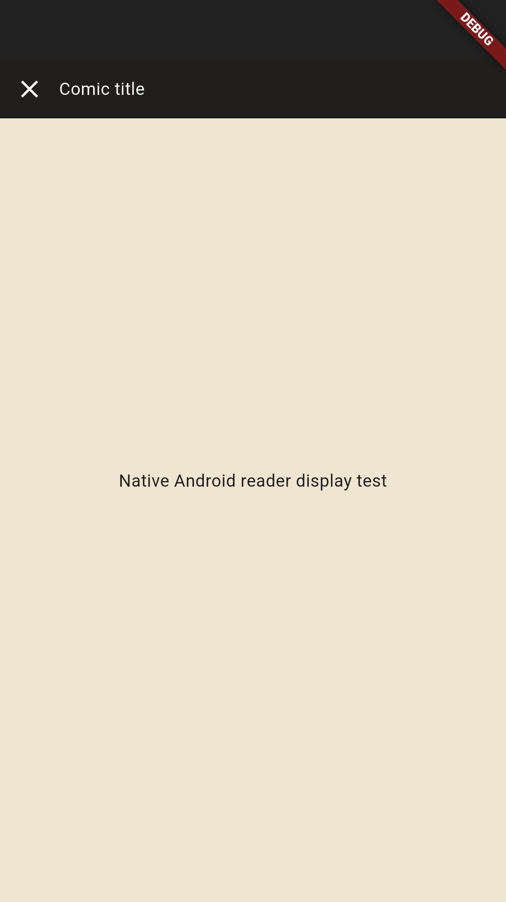
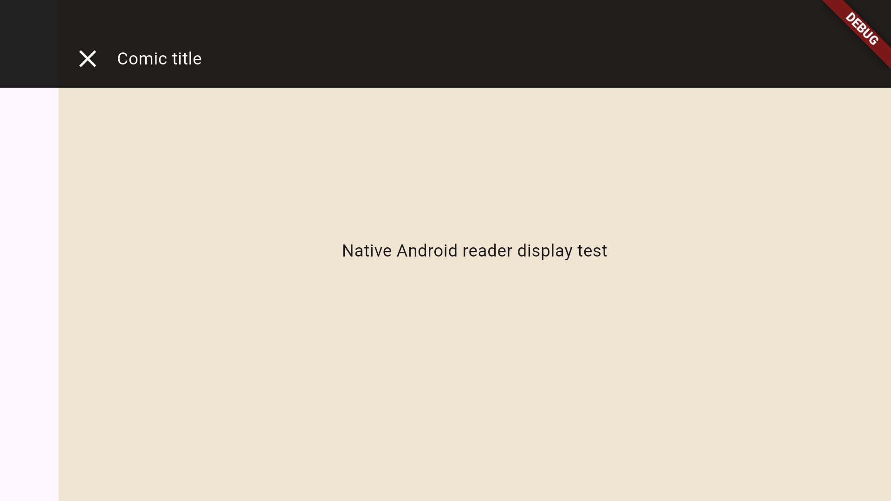
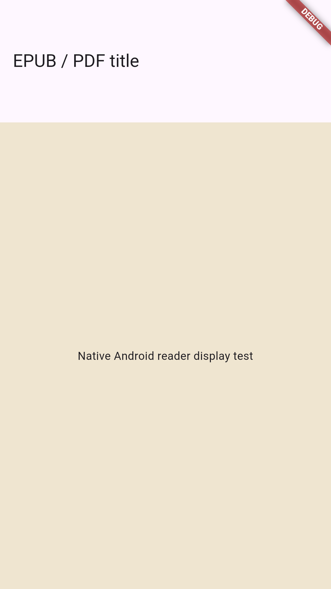
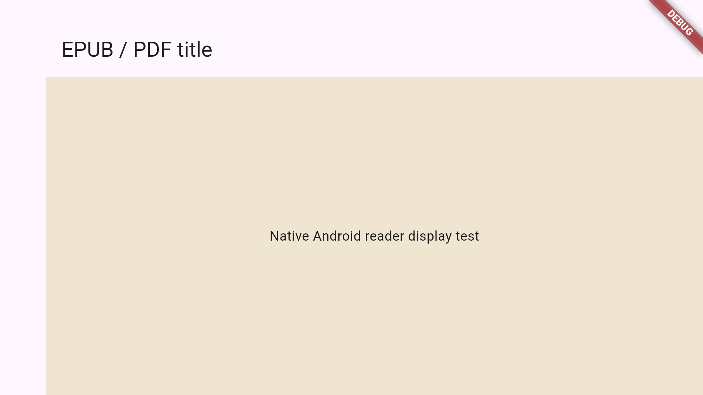
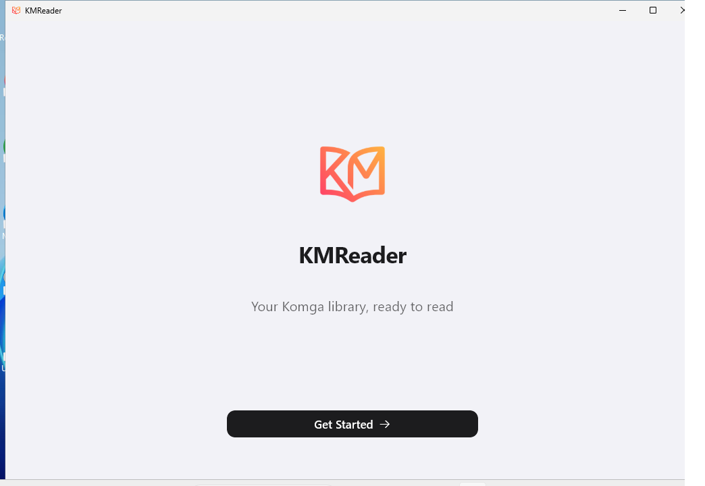

# Development validation

## 0.5.0 preview — verified notch handling and reader/dashboard options

Source: `d95a360f48d3045dc133458f19f3b539715cd19a`. All four jobs passed in
[workflow 40604419297](https://github.com/LeValue/KMReader-Porting/actions/runs/40604419297).
The [published preview](https://github.com/LeValue/KMReader-Porting/releases/tag/v0.5.0-preview.1) contains the verified Android and Windows files.

| Check | Observed result |
| --- | --- |
| Formatting and static analysis | Passed, including integration test/driver sources |
| Automated suites | 96 passed and one live test deliberately skipped, locally and on Linux/Windows CI |
| Real Komga integration | Passed separately locally and in CI, including recently-read/released dashboard filters |
| Native Android display test | Passed on API 35 x86_64 with the OS tall-cutout overlay enabled, including portrait/landscape and exit |
| Android release compilation | Passed locally and in CI |
| Windows release compilation/startup | Passed in CI; welcome window rendered in an isolated profile |
| Published downloads | Downloaded again; SHA256 manifest and GitHub asset digests matched |
| Android integrity | Retained certificate, version 0.5.0/code 6, release AOT/SQLite/PDFium in three ABIs, 16 KiB alignment |
| Windows portable bundle | x64 PE, AOT, native engines and MSVC runtime; every published file matched the CI artifact |

Android: 90,797,216 bytes,
SHA256 `0243474d3cb0ec756982f2ff40e5858379ee3783a8211cc79eefa825720c9efe`.

Windows ZIP: 19,986,126 bytes,
SHA256 `9e4cf92d961d2bc97aa181b428f789e363c7149ec64599cad90877b4ba074aa0`.
The tag points to the exact workflow source above.

The native test executes the real Kotlin MethodChannel/WindowInsets handler in
an Android window. It deliberately clears Flutter's safe padding, asserts a
nonzero OS-reported cutout, checks page and control geometry after rotation,
checks explicit cutout extension without moving controls under it, and checks
the shared document AppBar path. The screenshots below are from this small
display-test harness, not a complete reader acceptance session.

Additional unit/widget checks cover actual cropped pixels and safety thresholds,
vertical crop layout, configurable double-tap zoom, leap-year/month-end dashboard
cutoffs and persistent card styles without extra HTTP requests. Existing gesture,
split-page semantic-progress and EPUB/PDF checks remain passing.

The emulator establishes Android platform integration with a simulated cutout;
physical phones, legacy/vendor inset behavior and real frame times still require
target-device acceptance. Full functional/visual parity remains incomplete;
see [PARITY.md](PARITY.md). No pixel comparison against an Apple-host baseline
has been performed.

## 0.4.1 preview — verified comic-reader fixes

Source: `9332ee4bf67fcfa11db645b3941b4c5ae03c15a1`. All three jobs passed in
[workflow 40578135866](https://github.com/LeValue/KMReader-Porting/actions/runs/40578135866).
The [published preview](https://github.com/LeValue/KMReader-Porting/releases/tag/v0.4.1-preview.1) contains the verified Android and Windows files.

| Check | Observed result |
| --- | --- |
| Formatting and static analysis | Passed |
| Full automated suites | 90 passed and one live test deliberately skipped, locally and on Linux/Windows CI |
| Separate real Komga integration | Passed in Android CI |
| Android release compilation | Passed locally and independently in CI, including the native immersive-window handler |
| Windows release compilation/startup | Passed in CI; welcome window rendered in an isolated profile |
| Published downloads | Downloaded again; SHA256 manifest and GitHub asset digests matched |
| Android integrity | Same retained certificate, version 0.4.1/code 5, release AOT/SQLite/PDFium in all three ABIs and 16 KiB alignment |
| Windows portable bundle | x64 PE, AOT, native engines and MSVC runtime; every published file matched the CI artifact |

Android: 90,534,136 bytes,
SHA256 `2fba6a5a42b73b636e0af3ac6e7b0f683b5a41556764af49e4c201a18aa8f3bc`.

Windows ZIP: 19,967,519 bytes,
SHA256 `be231c0b66545f11733e66972653f1f96c43b99e624999950d5046190ae3ddaa`.
The release tag points to the exact workflow source above.

New tests exercise LTR/RTL paging, a second finger arriving after a swipe crosses
the midpoint, rollback without progress writes, remaining-finger pan, zoom reset,
desktop wheel zoom, reuse of the rendered subtree, vertical item recycling,
full viewport geometry with safe controls and Android system-UI ownership.
Existing wide-page pixel and semantic-progress checks continue to pass with the
decode target used for split pages. All three signed AOT snapshots were checked
for the new reader-display channel and differ from 0.4.0.

The user reported a successful quick Windows 0.4.0 smoke test. That feedback is
not exhaustive Windows acceptance. Physical Android frame times, touch behavior
and OEM system-bar/cutout behavior still require device validation. The broader
port remains incomplete; see [PARITY.md](PARITY.md).

## 0.4.0 preview — verified release

Source: `f23eaa42ec5713df1ce4f66d03c0124c9817690e`. All three jobs passed in
[workflow 40553979764](https://github.com/LeValue/KMReader-Porting/actions/runs/40553979764).
The [published preview](https://github.com/LeValue/KMReader-Porting/releases/tag/v0.4.0-preview.1) contains the verified Android and Windows files.
The locally signed APK's application/native sources match this commit; subsequent
delivery-tool changes were checked not to modify those sources before dispatch.

| Check | Observed result |
| --- | --- |
| Formatting and static analysis | Passed |
| Full automated suite | 85 passed and one live test deliberately skipped, locally and on both CI platforms |
| Separate real Komga 1.29.1 integration | Passed locally and in Android CI; mixed PNG/TIFF/JPEG2000 comic decoded offline |
| Android release compilation | Passed locally and independently in CI |
| Windows release compilation | Passed in CI |
| Native Windows startup | Window rendered the welcome screen and remained running in an isolated profile |
| Published downloads | Both downloaded again; SHA256 manifest and GitHub REST digests matched |
| Android integrity | Same retained certificate, version 0.4.0/code 4, nondebuggable manifest, AOT/SQLite/PDFium in all three ABIs, 16 KiB alignment |
| Windows portable bundle | x64 PE, AOT, SQLite, PDFium and MSVC runtime; every published file matched the CI artifact |

Android: package `dev.levalue.kmreader.preview`, 90,533,968 bytes,
SHA256 `b3b06a59f52eebfb457aaa0ecdb5c69607c5b9df1b06e1180c520599b2fc9bdf`.

Windows ZIP: 19,961,165 bytes,
SHA256 `8064f7b9e6da0c36064874e06cf30eec225e84c612d1508d3663414907aefb5e`.
The release tag points to the exact workflow source above.

Native PDFium widget tests cover mixed-size spreads, complete spread fitting,
cached series RTL, layout/theme changes without progress writes, normal/incognito
navigation, AES-128 wrong-password retry, actual text search and result/page
retention after viewport changes. EPUB tests navigate supplementary notes outside
the linear spine, return without changing canonical progress, and preserve the
scroll fraction across font and font-size changes. Download fixtures use a real
generated PNG rather than arbitrary non-image bytes.

These checks do not establish complete functional/visual parity or phone frame
times. Physical Android and manual Windows interaction, vault/background behavior,
AI/OCR and the other gaps in [PARITY.md](PARITY.md) still require work.

## 0.3.0 preview — verified release

Source: `77a5786fb19c173e7925b6a64e5d424ffb843eb3`.
All three jobs passed in [workflow 40516070398](https://github.com/LeValue/KMReader-Porting/actions/runs/40516070398).
The [published preview](https://github.com/LeValue/KMReader-Porting/releases/tag/v0.3.0-preview.1)
contains Android and Windows artifacts.

| Check | Observed result |
| --- | --- |
| Static analysis and formatting | Passed |
| Full automated suites | 73 passed and one live test intentionally skipped, on both Linux and Windows |
| Separate real Komga 1.29.1 integration | Passed in the Android CI job |
| Android release compilation | Passed locally and independently in CI |
| Windows release compilation | Passed in CI |
| Native Windows startup | Window created, remained running and rendered the welcome screen in an isolated profile |
| Windows bundle | x64 PE, AOT library, SQLite, PDFium and MSVC runtime verified |
| Published download verification | Both files downloaded again; manifest and GitHub REST asset digests matched |
| Android package integrity | Retained certificate, nondebuggable manifest, AOT/SQLite/PDFium in three ABIs and 16 KiB alignment verified |

Android: package `dev.levalue.kmreader.preview`, version `0.3.0` (code `3`),
90,320,204 bytes, SHA256
`496ab8d6c83cff9e390a11771d28c70e9374c24390640fce8ce79eb49d99b3e7`.

Windows ZIP: 19,924,818 bytes, SHA256
`be669e3de514c4830c60770a77e467f3a68442a697951f7c7e2cb951ca96ced2`.
Every file in the published Windows ZIP matched the exact CI bundle that passed
native startup. The release tag points to the verified source commit above.

The cache regression freezes the clock so an explicitly requested refresh cannot
be hidden by equal Windows timestamps. It also asserts that the fetched replacement
is reused without a third request. No timeout or assertion was removed to pass it.

The real-server test covers metadata edits/locks, nested filters, read-list reorder
and read-status filters, statistics fallback, collection CRUD, library creation,
editing/removal, authentication, reader/download and progress checks. Extended kmrs
smart-list/statistics endpoints use contract fixtures: the available real server is
stock Komga, whose 404 fallback was checked. No physical Android device was used.
Windows startup is not acceptance of every native reader/vault interaction. Full
visual, AI/OCR and OS-integration parity is not established.

## Earlier validation snapshots

Validated in the prepared Linux cloud workspace with Flutter 3.47.8, Dart
3.13.7, Java 21 and Android SDK 36. Upstream reference remained unchanged at
`e2b35f8796cc830fc6e7464e161b2172d8f916e9`.

| Check | Observed result |
| --- | --- |
| Dart formatting | All 28 Dart files formatted |
| `flutter analyze` | No issues |
| `flutter test --reporter expanded` | 27 passed; live Komga test deliberately skipped |
| `python3 tool/komga_smoke.py --jar …/komga-1.29.1.jar` | Separate real-server integration test passed |
| `flutter build apk --debug` | Universal Android development APK built |
| Android `apksigner verify --verbose` | Verified APK Signature Scheme v2, one signer |
| Android `zipalign -c -P 16 4` | Passed |
| APK contents | Flutter, PDFium and SQLite native libraries present for all three ABIs |
| Windows release build and automated tests | Passed on a GitHub Windows runner; see remote evidence below |
| Windows app interaction | Not run |
| Android device/emulator execution | Not run; no device or accelerated emulator available |

The real-server test uses a disposable Komga 1.29.1 with synthetic books. It
covers password/API-key authentication and revocation, search, ordered reading
lists and continuation, CBZ/EPUB/PDF downloads, offline comic pages and progress,
and canonical Readium progression synchronization. It never changes the
persistent development server.

The EPUB widget tests exercise actual taps in chapter hyperlinks and the nested
index, including escaped paths/fragments and asynchronously parsed chapters.
They verify that the requested heading is visible, that font changes preserve
the scroll fraction without sending new progress, that initial restoration
finishes before navigation is accepted, and that incognito navigation creates
neither persisted positions nor outgoing progress. Parser tests cover EPUB 3
namespace aliases/accessibility roles, EPUB 2 NCX, invalid links and spine fallback.

## Android artifact

- Path: `build/app/outputs/flutter-apk/app-debug.apk`
- Package: `dev.levalue.kmreader`
- Version: `0.1.0` (code `1`)
- Minimum SDK: 24; target/compile SDK: 36
- ABIs: `armeabi-v7a`, `arm64-v8a`, `x86_64`
- Size: 235,932,312 bytes
- SHA256: `476ec84a05b6e41de688e29c45e64e8cfc9179abe298c38b604769704e7449d2`

This is a development APK signed with a local debug key. Release signing is a
separate build configuration. APK signature/alignment checks establish package
integrity, not target-device behavior.

## Remaining acceptance work

The [parity matrix](PARITY.md) tracks missing functionality. Exact visual
matching has not been established against an Apple-host screenshot baseline.
Secure storage on both target systems, real-device reader
behavior, accessibility, background work and performance still require target
testing. This report records local checks; subsequent remote build results must
be verified separately in GitHub Actions.

## Remote Windows evidence

The Windows job for source commit
`3e5a7e03a81636e3da304b9723ae6abf9a3972eb` successfully completed dependency
resolution, static analysis, the automated test suite, `flutter build windows
--release`, and artifact upload:

https://github.com/LeValue/KMReader-Porting/actions/runs/40469392697/job/122072544496

The downloaded `windows` artifact (ID `12717309125`, 19,170,395 bytes) was inspected
as a ZIP. It includes a PE `kmreader.exe`, `flutter_windows.dll`, PDFium and SQLite
DLLs, and the compiled Dart AOT asset. This establishes compilation and bundle
contents, not manual interaction with the installed app. The Android setup job
in that initial run failed on the retired SDK `tools` package; the workflow now
requests `platform-tools` explicitly.

## Published Android preview

The corrected workflow completed its Android, Windows, and preview-publishing
jobs successfully:

https://github.com/LeValue/KMReader-Porting/actions/runs/40469954248

The Android job passed formatting, analysis, the automated suite, the separate
real Komga integration test, and universal debug APK compilation. The publishing
job uploaded both assets, compared their sizes and SHA256 digests with GitHub's
metadata, and then published the prerelease. The actual published APK was
downloaded back to the cloud workspace and independently passed SHA256,
`apksigner` v2 signature, and 16 KiB ZIP alignment checks. Flutter, PDFium and
SQLite libraries were confirmed for ARMv7, ARM64 and x86_64.

- Release: https://github.com/LeValue/KMReader-Porting/releases/tag/v0.1.0-dev.1
- Source: `39988b1c7e279b0c9c76038bd3b5ffa6211e431b`
- Asset: `KMReader-0.1.0-android-debug.apk`
- Size: 198,405,673 bytes
- SHA256: `657d84ddbd74d4d6f3bff0ae8c6ffd0c1f5bf978e4f36714d374538e41227303`

This is a separate CI build with the runner's development signing key; its
checksum differs from the earlier local APK documented above. GitHub login with
repository access is required to download from this private repository. Target
device interaction and complete functional/visual parity remain unverified.

## Optimized 0.2.0 preview

Local validation of the cache/UI iteration passed 38 tests (one separate live
test skipped in that suite), static analysis and the separate real Komga test.
See [PERFORMANCE.md](PERFORMANCE.md) for measured cache behavior and coverage.
The signed universal APK was built in release mode with AOT libraries for all
three ABIs, no debug kernel and no `application-debuggable` flag. Its manifest
launches `dev.levalue.kmreader.MainActivity` under the separate preview package.

- Package: `dev.levalue.kmreader.preview`, label `KMReader Preview`
- Version: `0.2.0` (code `2`), Android API 24 minimum / 36 target
- Local artifact: `build/app/outputs/flutter-apk/app-release.apk`
- Size: 88,332,640 bytes
- SHA256: `174194343bf8a974d0da4cb715b3a6de4a626974eee21043b388d54e344e49b9`
- Certificate: public SHA256 in `tool/preview-certificate.sha256`

This build installs alongside 0.1.0; it does not overwrite that app's storage.
The user reported successful real-server connection and comic/ebook reading
with 0.1.0, while also reporting UI lag. This optimized build still requires
fresh performance and behavior acceptance on the user's device.

The complete CI workflow for source
`fc5b32be6c613eb936696134cb598b40037f950b` succeeded for Android, Windows, and
preview publication:

https://github.com/LeValue/KMReader-Porting/actions/runs/40482167262

The exact signed APK was published at
https://github.com/LeValue/KMReader-Porting/releases/tag/v0.2.0-preview.1,
downloaded back through GitHub, and independently checked against its SHA256,
retained certificate, non-debuggable manifest, AOT/native libraries for all
three ABIs, APK signature and 16 KiB ZIP alignment. The downloaded file matches
the local artifact listed above byte for byte.
